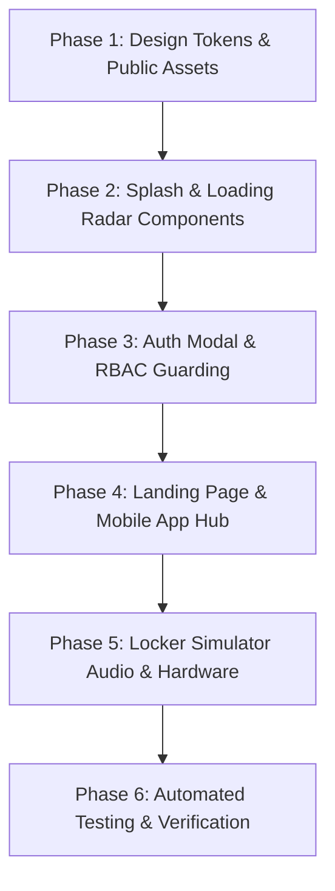

# KIOSKDROP ENTERPRISE — WEBSITE UPGRADE MASTER PLAN (v1.0.3)
**Architectural Blueprint & Implementation Guide for Autonomous Agent Execution**

> **Target Platform:** Next.js 14 (App Router) + TypeScript 5.5 + Tailwind CSS 3.4 + Prisma ORM + Web Audio API  
> **Mobile Parity Reference:** KioskDrop Enterprise Mobile App `v1.0.3` (`versionCode: 4`, Release Tag `v1.0.3`)  
> **Brand Guide Reference:** `brand-assets/brand-guide.json`  
> **Author:** Antigravity Senior Software Engineer & Autonomous Agent Architecture Lead  
> **Status:** APPROVED FOR EXECUTION — ZERO ERROR TOLERANCE

---

## 1. Executive Summary & Parity Matrix

The purpose of this upgrade is to bring the KioskDrop Enterprise public web platform into strict 100% visual, functional, and behavioral alignment with the newly launched Mobile Application (`v1.0.3`). The website acts as both the corporate entry point, the employee rapid-request portal, the 12-bay floor locker bank simulator, the ITAM/FinOps command center, and the primary distribution channel for the enterprise Android application.

### Mobile vs. Website Parity Matrix

| Feature Domain | Mobile App (`v1.0.3`) | Current Website | Target Upgraded Website |
| :--- | :--- | :--- | :--- |
| **Brand Identity** | Geometric KD Monogram (`\|>`), Obsidian canvas (`#070A10`), Slate card (`#0F172A`), Cyber Sky (`#38BDF8`) | Older dark background (`#0B0F17`), static SVG logo | Full `brand-guide.json` token adoption, cyber glass-chamfer cards, kinetic logo glow |
| **Boot Experience** | 4-Stage kinetic splash animation with live telemetry logs (`[SYS_INIT]`, `[IOT_SYNC]`) & skip button | Instant jump to page, no boot sequence | Web equivalent `WebSplashScreen.tsx` (4 stages, audio/visual pulse, escape/skip key, `sessionStorage` gate) |
| **Loading State** | Radar pulse wave modal with rotating dashed border and subsystem badge | Basic text spinner in `LoadingScreen.tsx` | `HardwareRadarModal.tsx` + Zero-CLS Shimmer Skeleton suite (`LockerBaySkeleton`, `StatCardSkeleton`) |
| **Authentication** | 3-Tab `LoginScreen.tsx` (Credentials, 1-Tap Quick Demo Personas, RFID Badge reader, Biometrics, Latency Ping) | Inline dropdown role switcher in `Navbar.tsx` only | Dedicated `/login` route + Universal `LoginModal.tsx` with all 3 modes, WebAuthn trigger, and latency check |
| **Role Navigation** | `EMPLOYEE` tab bar completely hides Admin; 403 screen on deep link | `Navbar.tsx` shows `Command Center` to all roles | `Navbar.tsx` conditionally hides `Command Center` for `EMPLOYEE`; `/admin` renders 403 Cyber Access Violation card |
| **Mobile App Hub** | N/A (Is the mobile app) | Missing entirely | Dedicated Hero & Showcase section with interactive CSS phone frame, direct APK download, SHA-256 copy, & Scan-to-Sideload QR code |
| **Locker Simulator** | Real-time solenoid feedback, haptics, battery continuity | Web Audio click sound, basic bay cards | Web Audio 120Hz mechanical solenoid actuator clack, simulated IR beam break, 5V/3A smart charging, IT Admin override drawer |

---

## 2. Design System & CSS Token Configuration

The website must consume the exact color hex codes and HSL channels defined in `brand-assets/brand-guide.json`.

### 2.1 CSS Variables (`src/app/globals.css`)
Replace the existing CSS variables in `src/app/globals.css` with the cyber-industrial obsidian design palette:

```css
@tailwind base;
@tailwind components;
@tailwind utilities;

@layer base {
  :root {
    --background: 210 20% 98%;
    --foreground: 222.2 84% 4.9%;
    --card: 0 0% 100%;
    --card-foreground: 222.2 84% 4.9%;
    --popover: 0 0% 100%;
    --popover-foreground: 222.2 84% 4.9%;
    --primary: 221.2 83.2% 53.3%; /* #2563EB Sapphire Blue */
    --primary-foreground: 210 40% 98%;
    --secondary: 210 40% 96.1%;
    --secondary-foreground: 222.2 47.4% 11.2%;
    --muted: 210 40% 96.1%;
    --muted-foreground: 215.4 16.3% 46.9%;
    --accent: 199 95% 64%; /* #38BDF8 Cyber Sky */
    --accent-foreground: 222.2 47.4% 11.2%;
    --destructive: 0 84.2% 60.2%; /* #EF4444 Crimson Alarm */
    --destructive-foreground: 210 40% 98%;
    --success: 160 84% 39%; /* #10B981 Emerald Zero-Trust */
    --warning: 38 92% 50%; /* #F59E0B Amber Quarantine */
    --border: 214.3 31.8% 91.4%;
    --input: 214.3 31.8% 91.4%;
    --ring: 221.2 83.2% 53.3%;
    --radius: 0.75rem;
  }

  .dark {
    /* Brand Obsidian Canvas: #070A10 */
    --background: 220 39% 5%; 
    --foreground: 215 25% 94%; 
    /* Brand Slate Card: #0F172A */
    --card: 222 47% 11%; 
    --card-foreground: 215 25% 94%;
    --popover: 222 47% 11%;
    --popover-foreground: 215 25% 94%;
    /* Brand Sapphire Blue: #2563EB */
    --primary: 221 83% 53%; 
    --primary-foreground: 210 40% 98%;
    --secondary: 222 30% 15%; 
    --secondary-foreground: 215 25% 94%;
    --muted: 222 30% 15%; 
    --muted-foreground: 215 20% 68%; 
    /* Brand Cyber Sky: #38BDF8 */
    --accent: 199 95% 64%; 
    --accent-foreground: 220 39% 5%;
    /* Brand Crimson Alarm: #EF4444 */
    --destructive: 0 84% 60%; 
    --destructive-foreground: 210 40% 98%;
    /* Brand Emerald Zero-Trust: #10B981 */
    --success: 160 84% 39%;
    /* Brand Amber Quarantine: #F59E0B */
    --warning: 38 92% 50%;
    --border: 222 30% 18%; 
    --input: 222 30% 18%;
    --ring: 199 95% 64%;
  }
}

body {
  color: hsl(var(--foreground));
  background: hsl(var(--background));
  font-feature-settings: "rlig" 1, "calt" 1;
}

/* Cyber-industrial glass-chamfer utilities */
.glass-chamfer {
  box-shadow: inset 0 1px 0 0 rgba(255, 255, 255, 0.08), 0 4px 20px -2px rgba(0, 0, 0, 0.5);
  border: 1px solid rgba(255, 255, 255, 0.07);
}

.cyber-glow-blue {
  box-shadow: 0 0 25px -5px rgba(37, 99, 235, 0.35);
}

.cyber-glow-sky {
  box-shadow: 0 0 25px -5px rgba(56, 189, 248, 0.35);
}

.cyber-glow-emerald {
  box-shadow: 0 0 25px -5px rgba(16, 185, 129, 0.35);
}

/* Shimmer animation for skeletons */
@keyframes shimmer {
  0% { transform: translateX(-100%); }
  100% { transform: translateX(100%); }
}

.animate-shimmer {
  position: relative;
  overflow: hidden;
}
.animate-shimmer::after {
  position: absolute;
  top: 0; right: 0; bottom: 0; left: 0;
  transform: translateX(-100%);
  background-image: linear-gradient(
    90deg,
    rgba(255, 255, 255, 0) 0,
    rgba(255, 255, 255, 0.06) 20%,
    rgba(255, 255, 255, 0.12) 60%,
    rgba(255, 255, 255, 0)
  );
  animation: shimmer 1.8s infinite;
  content: "";
}
```

### 2.2 Tailwind Config Extensions (`tailwind.config.js`)
Ensure `tailwind.config.js` declares the brand color mappings and custom animation utilities:
```js
/** @type {import('tailwindcss').Config} */
module.exports = {
  darkMode: ["class"],
  content: [
    "./src/pages/**/*.{js,ts,jsx,tsx,mdx}",
    "./src/components/**/*.{js,ts,jsx,tsx,mdx}",
    "./src/app/**/*.{js,ts,jsx,tsx,mdx}",
  ],
  theme: {
    extend: {
      colors: {
        obsidian: "#070A10",
        slateCard: "#0F172A",
        sapphire: "#2563EB",
        cyberSky: "#38BDF8",
        emeraldZT: "#10B981",
        amberQuarantine: "#F59E0B",
        crimsonAlarm: "#EF4444",
        border: "hsl(var(--border))",
        input: "hsl(var(--input))",
        ring: "hsl(var(--ring))",
        background: "hsl(var(--background))",
        foreground: "hsl(var(--foreground))",
        primary: {
          DEFAULT: "hsl(var(--primary))",
          foreground: "hsl(var(--primary-foreground))",
        },
        secondary: {
          DEFAULT: "hsl(var(--secondary))",
          foreground: "hsl(var(--secondary-foreground))",
        },
        destructive: {
          DEFAULT: "hsl(var(--destructive))",
          foreground: "hsl(var(--destructive-foreground))",
        },
        muted: {
          DEFAULT: "hsl(var(--muted))",
          foreground: "hsl(var(--muted-foreground))",
        },
        accent: {
          DEFAULT: "hsl(var(--accent))",
          foreground: "hsl(var(--accent-foreground))",
        },
        card: {
          DEFAULT: "hsl(var(--card))",
          foreground: "hsl(var(--card-foreground))",
        },
      },
      borderRadius: {
        lg: "var(--radius)",
        md: "calc(var(--radius) - 2px)",
        sm: "calc(var(--radius) - 4px)",
      },
    },
  },
  plugins: [],
};
```

---

## 3. Kinetic Boot Sequence & Splash Screen (`src/components/WebSplashScreen.tsx`)

### 3.1 Component Specification
The web application must introduce a client-side kinetic boot sequence equivalent to `mobile/src/components/ui/AppSplashScreen.tsx`.

1. **Duration:** 1,750ms total sequence.
2. **Session Gate:** Stored in `sessionStorage.getItem('kioskdrop_boot_shown')`. If set, the splash sequence is skipped automatically, preventing annoying repeated reloads during normal navigation.
3. **Skip Trigger:** Pressing `Escape` or clicking "Skip Boot" immediately executes a 150ms fast-fade transition.
4. **4 Kinetic Stages:**
   - **Stage 1 (0–480ms):** Elastic entrance of the KD Monogram logo (`scale: 0.85 -> 1.0`, `opacity: 0 -> 1`).
   - **Stage 2 (380–630ms):** Chevron Drop flash with glowing Cyber Sky (`#38BDF8`) aura.
   - **Stage 3 (450–900ms):** Staggered reveal of "KioskDrop Enterprise" typography and zero-trust subtitle.
   - **Stage 4 (1300–1750ms):** Smooth aperture zoom-out (`scale: 1 -> 1.15`, `opacity: 1 -> 0`) revealing the underlying application.
5. **Live Telemetry Stream:**
   - `0ms`: `[SYS_INIT] Initializing Zero-Trust Security Enclave...`
   - `400ms`: `[IOT_SYNC] Syncing Smart Locker SSE Bus...`
   - `800ms`: `[SEC_PASS] Authorizing Bay Solenoid Matrix...`
   - `1200ms`: `[FLEET_OK] Enterprise Fleet Online.`

### 3.2 Full Source Code: `src/components/WebSplashScreen.tsx`
```tsx
"use client";

import React, { useEffect, useState, useCallback } from "react";
import { KioskDropLogo } from "./KioskDropLogo";

export interface WebSplashScreenProps {
  onFinish?: () => void;
  minDurationMs?: number;
}

const BOOT_LOGS = [
  "[SYS_INIT] Initializing Zero-Trust Security Enclave...",
  "[IOT_SYNC] Syncing Smart Locker SSE Bus...",
  "[SEC_PASS] Authorizing Bay Solenoid Matrix...",
  "[FLEET_OK] Enterprise Fleet Online.",
];

export function WebSplashScreen({
  onFinish,
  minDurationMs = 1750,
}: WebSplashScreenProps) {
  const [isVisible, setIsVisible] = useState(true);
  const [stage, setStage] = useState<1 | 2 | 3 | 4>(1);
  const [logIndex, setLogIndex] = useState(0);
  const [isDismissing, setIsDismissing] = useState(false);

  const dismiss = useCallback(
    (fast = false) => {
      if (isDismissing) return;
      setIsDismissing(true);
      try {
        sessionStorage.setItem("kioskdrop_boot_shown", "true");
      } catch {}

      setTimeout(
        () => {
          setIsVisible(false);
          onFinish?.();
        },
        fast ? 150 : 380
      );
    },
    [isDismissing, onFinish]
  );

  useEffect(() => {
    // Check if boot was already displayed in this browser tab
    try {
      if (sessionStorage.getItem("kioskdrop_boot_shown") === "true") {
        setIsVisible(false);
        onFinish?.();
        return;
      }
    } catch {}

    // Stage 1 -> 2: Chevron Drop Flash
    const t1 = setTimeout(() => setStage(2), 380);
    // Stage 2 -> 3: Brand Lockup Reveal
    const t2 = setTimeout(() => setStage(3), 480);
    // Stage 3 -> 4: Exit Aperture Zoom
    const t3 = setTimeout(() => {
      setStage(4);
      dismiss(false);
    }, minDurationMs);

    // Telemetry log stepper
    const l1 = setTimeout(() => setLogIndex(1), 400);
    const l2 = setTimeout(() => setLogIndex(2), 850);
    const l3 = setTimeout(() => setLogIndex(3), 1250);

    const handleKeyDown = (e: KeyboardEvent) => {
      if (e.key === "Escape" || e.key === "Enter" || e.key === " ") {
        dismiss(true);
      }
    };
    window.addEventListener("keydown", handleKeyDown);

    return () => {
      clearTimeout(t1);
      clearTimeout(t2);
      clearTimeout(t3);
      clearTimeout(l1);
      clearTimeout(l2);
      clearTimeout(l3);
      window.removeEventListener("keydown", handleKeyDown);
    };
  }, [minDurationMs, dismiss, onFinish]);

  if (!isVisible) return null;

  return (
    <div
      role="dialog"
      aria-label="System Initializing"
      aria-modal="true"
      className={`fixed inset-0 z-[100] flex flex-col items-center justify-center bg-[#070A10] text-white select-none transition-all duration-300 ${
        isDismissing ? "opacity-0 scale-105 pointer-events-none" : "opacity-100 scale-100"
      }`}
    >
      {/* Background ambient spotlight */}
      <div className="absolute top-1/2 left-1/2 -translate-x-1/2 -translate-y-1/2 w-[600px] h-[600px] bg-[radial-gradient(circle,rgba(56,189,248,0.12),transparent_70%)] blur-3xl pointer-events-none" />

      {/* Center Kinetic Logo Lockup */}
      <div className="relative z-10 flex flex-col items-center text-center px-4 max-w-md">
        {/* Monogram with animated aperture pulse */}
        <div
          className={`relative flex items-center justify-center w-28 h-28 mb-8 transition-transform duration-500 ease-out ${
            stage >= 1 ? "scale-100 opacity-100" : "scale-85 opacity-0"
          }`}
        >
          {/* Rotating radar aura ring */}
          <div className="absolute inset-0 rounded-full border border-dashed border-sky-400/40 animate-[spin_8s_linear_infinite]" />
          <div className="absolute -inset-2 rounded-full bg-sky-500/10 blur-md animate-pulse" />

          {/* Monogram Icon */}
          <div className="relative w-20 h-20 rounded-2xl bg-[#0F172A] border border-white/10 p-3.5 shadow-2xl shadow-blue-500/20">
            <KioskDropLogo variant="icon" className="w-full h-full text-white" />
          </div>
        </div>

        {/* Brand Name Lockup */}
        <div
          className={`transition-all duration-500 delay-100 ${
            stage >= 3 ? "translate-y-0 opacity-100" : "translate-y-4 opacity-0"
          }`}
        >
          <div className="inline-flex items-center gap-2 px-3 py-1 rounded-full bg-blue-500/10 border border-blue-500/30 text-blue-400 text-xs font-mono font-bold tracking-wider uppercase mb-3">
            <span className="w-2 h-2 rounded-full bg-emerald-400 animate-ping" />
            Zero-Trust Gateway v1.0.3
          </div>
          <h1 className="text-3xl sm:text-4xl font-extrabold tracking-tight text-white mb-2">
            Kiosk<span className="text-blue-500">Drop</span> Enterprise
          </h1>
          <p className="text-xs text-slate-400 max-w-xs mx-auto leading-relaxed">
            Automated conference room AV micro-logistics platform & smart locker fleet.
          </p>
        </div>

        {/* Live Telemetry Code Terminal */}
        <div className="w-full mt-8 p-3 rounded-xl bg-slate-900/80 border border-slate-800 text-left font-mono text-[11px] text-sky-400 shadow-inner">
          <div className="flex items-center justify-between border-b border-slate-800 pb-1.5 mb-2 text-slate-500 text-[10px] uppercase tracking-wider">
            <span>Hardware Telemetry Bus</span>
            <span>PORT_443_SECURE</span>
          </div>
          <div className="flex items-center gap-2">
            <span className="text-emerald-400">❯</span>
            <span className="animate-pulse">{BOOT_LOGS[logIndex]}</span>
          </div>
        </div>

        {/* Skip Action */}
        <button
          onClick={() => dismiss(true)}
          className="mt-6 text-xs text-slate-500 hover:text-slate-300 font-medium transition-colors underline-offset-4 hover:underline"
        >
          Skip Boot (Esc)
        </button>
      </div>
    </div>
  );
}
```

---

## 4. Hardware Loading Radar & Zero-CLS Skeletons

### 4.1 Component: `src/components/HardwareRadarModal.tsx`
Web implementation of `mobile/src/components/ui/LoadingScreen.tsx` for asynchronous locker reservations, solenoid unlocking, and ITAM operations.

```tsx
"use client";

import React, { useEffect } from "react";
import { KioskDropLogo } from "./KioskDropLogo";
import { X } from "lucide-react";

export interface HardwareRadarModalProps {
  visible: boolean;
  title?: string;
  message?: string;
  subsystem?: string;
  onCancel?: () => void;
  cancelLabel?: string;
}

export function HardwareRadarModal({
  visible,
  title = "Connecting to Smart Locker...",
  message = "Authorizing hardware solenoid channel...",
  subsystem = "IOT_SOLENOID_DISPATCH",
  onCancel,
  cancelLabel = "Cancel Operation",
}: HardwareRadarModalProps) {
  useEffect(() => {
    if (!visible) return;
    const handleKeyDown = (e: KeyboardEvent) => {
      if (e.key === "Escape" && onCancel) {
        onCancel();
      }
    };
    window.addEventListener("keydown", handleKeyDown);
    return () => window.removeEventListener("keydown", handleKeyDown);
  }, [visible, onCancel]);

  if (!visible) return null;

  return (
    <div
      role="dialog"
      aria-modal="true"
      aria-label={title}
      className="fixed inset-0 z-50 flex items-center justify-center bg-black/70 backdrop-blur-md transition-opacity animate-in fade-in duration-200"
    >
      <div className="relative w-full max-w-sm mx-4 p-8 rounded-3xl bg-[#0F172A] border border-slate-700/80 shadow-2xl shadow-blue-500/10 flex flex-col items-center text-center text-white glass-chamfer">
        {onCancel && (
          <button
            onClick={onCancel}
            aria-label="Close"
            className="absolute top-4 right-4 p-1.5 rounded-lg text-slate-400 hover:text-white hover:bg-slate-800 transition-colors"
          >
            <X className="w-4 h-4" />
          </button>
        )}

        {/* Concentric Radar Rings & Glowing Monogram */}
        <div className="relative flex items-center justify-center w-28 h-28 mb-6">
          <div className="absolute inset-0 rounded-full bg-sky-500/15 animate-ping duration-1000" />
          <div className="absolute -inset-2 rounded-full border border-dashed border-sky-400/40 animate-[spin_6s_linear_infinite]" />
          <div className="relative flex items-center justify-center w-16 h-16 rounded-2xl bg-slate-900 border border-slate-700 shadow-lg p-3">
            <KioskDropLogo variant="icon" className="w-full h-full text-white" />
          </div>
        </div>

        {/* Subsystem Code Pill */}
        <div className="inline-flex items-center gap-1.5 px-2.5 py-0.5 rounded-full bg-blue-500/10 border border-blue-500/30 text-sky-400 text-[10px] font-mono font-bold tracking-wider uppercase mb-3">
          <span className="w-1.5 h-1.5 rounded-full bg-emerald-400 animate-pulse" />
          {subsystem}
        </div>

        {/* Title & Message */}
        <h3 className="text-lg font-bold text-white tracking-tight mb-1">{title}</h3>
        <p className="text-xs text-slate-400 leading-relaxed mb-6">{message}</p>

        {onCancel && (
          <button
            type="button"
            onClick={onCancel}
            className="w-full py-2.5 rounded-xl text-xs font-semibold text-slate-300 hover:text-white bg-slate-800 hover:bg-slate-700 border border-slate-700 transition-colors"
          >
            {cancelLabel}
          </button>
        )}
      </div>
    </div>
  );
}
```

### 4.2 Zero-Layout-Shift Shimmer Skeletons (`src/components/skeletons/`)
Create three high-performance skeleton components to eliminate Cumulative Layout Shift (CLS):

1. **`src/components/skeletons/StatCardSkeleton.tsx`**:
   ```tsx
   export function StatCardSkeleton() {
     return (
       <div className="p-5 rounded-2xl bg-card border border-border/80 animate-shimmer glass-chamfer">
         <div className="flex items-center justify-between mb-3">
           <div className="w-24 h-3.5 bg-muted rounded-md" />
           <div className="w-7 h-7 bg-muted rounded-lg" />
         </div>
         <div className="w-20 h-7 bg-muted rounded-lg mb-2" />
         <div className="w-36 h-3 bg-muted rounded-md" />
       </div>
     );
   }
   ```

2. **`src/components/skeletons/LockerBaySkeleton.tsx`**:
   ```tsx
   export function LockerBaySkeleton() {
     return (
       <div className="grid grid-cols-2 sm:grid-cols-3 md:grid-cols-4 gap-3">
         {Array.from({ length: 12 }).map((_, i) => (
           <div
             key={i}
             className="h-32 rounded-2xl bg-card border border-border/80 p-3.5 flex flex-col justify-between animate-shimmer glass-chamfer"
           >
             <div className="flex items-center justify-between">
               <div className="w-12 h-4 bg-muted rounded" />
               <div className="w-5 h-5 bg-muted rounded-full" />
             </div>
             <div className="w-24 h-3 bg-muted rounded mt-2" />
             <div className="w-full h-8 bg-muted rounded-lg mt-3" />
           </div>
         ))}
       </div>
     );
   }
   ```

3. **`src/components/skeletons/ChartSkeleton.tsx`**:
   ```tsx
   export function ChartSkeleton() {
     return (
       <div className="p-6 rounded-2xl bg-card border border-border/80 animate-shimmer glass-chamfer">
         <div className="w-48 h-5 bg-muted rounded mb-4" />
         <div className="w-full h-64 bg-muted/50 rounded-xl" />
       </div>
     );
   }
   ```

---

## 5. Enterprise Authentication Modal & Dedicated Route (`/login`)

The website currently only provides an inline persona switcher in `Navbar.tsx`. To match the mobile app's comprehensive authentication UX, the web platform must provide both:
1. A full dedicated page: `src/app/login/page.tsx`
2. A reusable floating modal: `src/components/LoginModal.tsx`

### 5.1 Persona Definitions & Test Credentials
The 3 demo personas mirror the mobile application:
- **Aarav Sharma (`EMPLOYEE`)**:
  - Email: `aarav.sharma@enterprise.corp` / Password: `kiosk2026`
  - RFID Badge: `RFID-EMP-8821` | Badge Tone: `Sapphire Blue`
  - Scope: Meeting room triage, QR door scan, PIN locker pickup.
- **Priya Patel (`IT_ADMIN`)**:
  - Email: `priya.patel@enterprise.corp` / Password: `kiosk2026`
  - RFID Badge: `RFID-IT-0042` | Badge Tone: `Emerald Zero-Trust`
  - Scope: Superuser, USB Zero-Trust Whitelist, Purchase Orders, Webhooks, Emergency Solenoid Override.
- **Vikram Malhotra (`FINOPS_AUDITOR`)**:
  - Email: `vikram.malhotra@enterprise.corp` / Password: `kiosk2026`
  - RFID Badge: `RFID-FIN-1109` | Badge Tone: `Amber Quarantine`
  - Scope: Read-only Indian Customs Duty (HSN tariffs), Landed CIF, Corporate cards ledger.

### 5.2 Source Code: `src/components/LoginModal.tsx`
```tsx
"use client";

import React, { useState, useEffect } from "react";
import {
  X,
  CreditCard,
  Mail,
  Lock,
  Radio,
  Eye,
  EyeOff,
  UserCheck,
  CheckCircle2,
  AlertTriangle,
  ArrowRight,
  Wifi,
} from "lucide-react";
import { KioskDropLogo } from "./KioskDropLogo";

type LoginTab = "credentials" | "demo" | "rfid";

export interface LoginModalProps {
  isOpen: boolean;
  onClose: () => void;
  onSuccess?: (session: any) => void;
}

const DEMO_PERSONAS = [
  {
    role: "EMPLOYEE",
    name: "Aarav Sharma",
    email: "aarav.sharma@enterprise.corp",
    department: "Sales & Strategic Accounts",
    rfidBadgeId: "RFID-EMP-8821",
    badgeColor: "border-blue-500/40 bg-blue-500/10 text-blue-400",
    description: "Rapid AV Request, QR Scanning & Locker Pickup",
  },
  {
    role: "IT_ADMIN",
    name: "Priya Patel",
    email: "priya.patel@enterprise.corp",
    department: "Enterprise Infrastructure & AV Ops",
    rfidBadgeId: "RFID-IT-0042",
    badgeColor: "border-emerald-500/40 bg-emerald-500/10 text-emerald-400",
    description: "Full Superuser: USB Zero-Trust, POs & Webhooks",
  },
  {
    role: "FINOPS_AUDITOR",
    name: "Vikram Malhotra",
    email: "vikram.malhotra@enterprise.corp",
    department: "Corporate Procurement & FinOps",
    rfidBadgeId: "RFID-FIN-1109",
    badgeColor: "border-amber-500/40 bg-amber-500/10 text-amber-400",
    description: "Read-Only Indian Customs Duty & Card Audits",
  },
];

export function LoginModal({ isOpen, onClose, onSuccess }: LoginModalProps) {
  const [activeTab, setActiveTab] = useState<LoginTab>("credentials");
  const [email, setEmail] = useState("aarav.sharma@enterprise.corp");
  const [password, setPassword] = useState("kiosk2026");
  const [showPassword, setShowPassword] = useState(false);
  const [rfidInput, setRfidInput] = useState("RFID-EMP-8821");
  const [loading, setLoading] = useState(false);
  const [errorMsg, setErrorMsg] = useState<string | null>(null);
  const [pingLatency, setPingLatency] = useState<number | null>(null);

  useEffect(() => {
    if (isOpen) {
      // Test server latency on open
      const start = performance.now();
      fetch("/api/session/current")
        .then(() => {
          setPingLatency(Math.round(performance.now() - start));
        })
        .catch(() => setPingLatency(null));
    }
  }, [isOpen]);

  if (!isOpen) return null;

  const handleLogin = async (body: any) => {
    setLoading(true);
    setErrorMsg(null);
    try {
      const res = await fetch("/api/auth/login", {
        method: "POST",
        headers: { "Content-Type": "application/json" },
        body: JSON.stringify(body),
      });
      const data = await res.json();
      if (!res.ok || !data.success) {
        throw new Error(data.message || "Authentication failed. Check credentials.");
      }
      onSuccess?.(data.data.session);
      onClose();
      window.location.reload();
    } catch (err: any) {
      setErrorMsg(err.message || "Network communication error.");
    } finally {
      setLoading(false);
    }
  };

  return (
    <div
      role="dialog"
      aria-modal="true"
      className="fixed inset-0 z-50 flex items-center justify-center bg-black/75 backdrop-blur-md p-4 animate-in fade-in duration-200"
    >
      <div className="relative w-full max-w-lg rounded-3xl bg-[#0F172A] border border-slate-700/80 shadow-2xl p-6 sm:p-8 text-white glass-chamfer">
        {/* Close Button */}
        <button
          onClick={onClose}
          className="absolute top-5 right-5 p-2 rounded-xl text-slate-400 hover:text-white hover:bg-slate-800 transition-colors"
        >
          <X className="w-5 h-5" />
        </button>

        {/* Header */}
        <div className="flex items-center gap-3 mb-6">
          <div className="w-10 h-10 rounded-xl bg-slate-900 border border-slate-700 flex items-center justify-center p-2">
            <KioskDropLogo variant="icon" className="w-full h-full text-white" />
          </div>
          <div>
            <h2 className="text-lg font-bold">Enterprise Authentication</h2>
            <div className="flex items-center gap-2 text-xs text-slate-400">
              <span>Zero-Trust Gateway v1.0.3</span>
              {pingLatency !== null && (
                <span className="inline-flex items-center gap-1 text-emerald-400 font-mono text-[10px]">
                  <Wifi className="w-3 h-3" /> {pingLatency}ms
                </span>
              )}
            </div>
          </div>
        </div>

        {/* Mode Tabs */}
        <div className="grid grid-cols-3 gap-1 bg-slate-900/80 p-1 rounded-2xl border border-slate-800 mb-6 text-xs font-semibold">
          <button
            onClick={() => setActiveTab("credentials")}
            className={`py-2 rounded-xl transition-all ${
              activeTab === "credentials"
                ? "bg-blue-600 text-white shadow-md"
                : "text-slate-400 hover:text-white"
            }`}
          >
            Credentials
          </button>
          <button
            onClick={() => setActiveTab("demo")}
            className={`py-2 rounded-xl transition-all ${
              activeTab === "demo"
                ? "bg-blue-600 text-white shadow-md"
                : "text-slate-400 hover:text-white"
            }`}
          >
            1-Tap Demo
          </button>
          <button
            onClick={() => setActiveTab("rfid")}
            className={`py-2 rounded-xl transition-all ${
              activeTab === "rfid"
                ? "bg-blue-600 text-white shadow-md"
                : "text-slate-400 hover:text-white"
            }`}
          >
            RFID Tap
          </button>
        </div>

        {/* Error Alert */}
        {errorMsg && (
          <div className="mb-4 p-3 rounded-xl bg-rose-500/10 border border-rose-500/30 text-rose-400 text-xs flex items-center gap-2">
            <AlertTriangle className="w-4 h-4 shrink-0" />
            <span>{errorMsg}</span>
          </div>
        )}

        {/* Tab 1: Credentials */}
        {activeTab === "credentials" && (
          <form
            onSubmit={(e) => {
              e.preventDefault();
              handleLogin({ email, password });
            }}
            className="space-y-4"
          >
            <div>
              <label className="block text-xs font-medium text-slate-300 mb-1.5">
                Corporate Email Address
              </label>
              <div className="relative">
                <Mail className="absolute left-3.5 top-1/2 -translate-y-1/2 w-4 h-4 text-slate-400" />
                <input
                  type="email"
                  value={email}
                  onChange={(e) => setEmail(e.target.value)}
                  required
                  placeholder="employee@enterprise.corp"
                  className="w-full pl-10 pr-4 py-2.5 rounded-xl bg-slate-900 border border-slate-700 text-xs text-white focus:outline-none focus:border-blue-500"
                />
              </div>
            </div>

            <div>
              <label className="block text-xs font-medium text-slate-300 mb-1.5">
                Directory Password
              </label>
              <div className="relative">
                <Lock className="absolute left-3.5 top-1/2 -translate-y-1/2 w-4 h-4 text-slate-400" />
                <input
                  type={showPassword ? "text" : "password"}
                  value={password}
                  onChange={(e) => setPassword(e.target.value)}
                  required
                  placeholder="••••••••"
                  className="w-full pl-10 pr-10 py-2.5 rounded-xl bg-slate-900 border border-slate-700 text-xs text-white focus:outline-none focus:border-blue-500"
                />
                <button
                  type="button"
                  onClick={() => setShowPassword(!showPassword)}
                  className="absolute right-3 top-1/2 -translate-y-1/2 text-slate-400 hover:text-slate-200"
                >
                  {showPassword ? <EyeOff className="w-4 h-4" /> : <Eye className="w-4 h-4" />}
                </button>
              </div>
            </div>

            <button
              type="submit"
              disabled={loading}
              className="w-full mt-2 py-3 rounded-xl bg-blue-600 hover:bg-blue-500 text-white text-xs font-bold transition-all shadow-lg shadow-blue-500/25 flex items-center justify-center gap-2 disabled:opacity-50"
            >
              {loading ? "Authorizing Identity..." : "Sign In with Enterprise Directory"}
              <ArrowRight className="w-4 h-4" />
            </button>
          </form>
        )}

        {/* Tab 2: 1-Tap Quick Demo */}
        {activeTab === "demo" && (
          <div className="space-y-3">
            <p className="text-xs text-slate-400 mb-2">
              Select an enterprise persona to authenticate instantly with appropriate role permissions:
            </p>
            {DEMO_PERSONAS.map((p) => (
              <button
                key={p.role}
                onClick={() => handleLogin({ role: p.role })}
                disabled={loading}
                className="w-full p-3.5 rounded-2xl bg-slate-900 hover:bg-slate-800 border border-slate-700/80 hover:border-blue-500/50 transition-all text-left flex items-start justify-between group"
              >
                <div>
                  <div className="flex items-center gap-2">
                    <span className="font-bold text-xs text-white">{p.name}</span>
                    <span
                      className={`text-[10px] font-mono font-bold px-2 py-0.5 rounded-md border ${p.badgeColor}`}
                    >
                      {p.role}
                    </span>
                  </div>
                  <div className="text-[11px] text-slate-400 mt-1">{p.department}</div>
                  <div className="text-[10px] text-slate-500 mt-0.5">{p.description}</div>
                </div>
                <ArrowRight className="w-4 h-4 text-slate-500 group-hover:text-blue-400 group-hover:translate-x-1 transition-all mt-1" />
              </button>
            ))}
          </div>
        )}

        {/* Tab 3: RFID Badge Reader Simulation */}
        {activeTab === "rfid" && (
          <div className="space-y-4 text-center">
            <div className="relative mx-auto w-24 h-24 rounded-full bg-slate-900 border border-slate-700 flex items-center justify-center">
              <div className="absolute inset-0 rounded-full border border-dashed border-sky-400/40 animate-[spin_10s_linear_infinite]" />
              <Radio className="w-10 h-10 text-sky-400 animate-pulse" />
            </div>
            <p className="text-xs text-slate-400 max-w-xs mx-auto">
              Simulate tapping an employee physical NFC/RFID badge against the kiosk reader:
            </p>

            <div className="flex gap-2">
              <input
                type="text"
                value={rfidInput}
                onChange={(e) => setRfidInput(e.target.value)}
                placeholder="RFID-EMP-8821"
                className="flex-1 px-3 py-2 rounded-xl bg-slate-900 border border-slate-700 text-xs font-mono text-center text-sky-400 focus:outline-none focus:border-blue-500"
              />
              <button
                onClick={() => handleLogin({ rfidBadgeId: rfidInput })}
                disabled={loading}
                className="px-4 py-2 rounded-xl bg-blue-600 hover:bg-blue-500 text-white text-xs font-bold transition-all"
              >
                Tap Badge
              </button>
            </div>

            <div className="flex justify-center gap-2 pt-2">
              {DEMO_PERSONAS.map((p) => (
                <button
                  key={p.rfidBadgeId}
                  onClick={() => {
                    setRfidInput(p.rfidBadgeId);
                    handleLogin({ rfidBadgeId: p.rfidBadgeId });
                  }}
                  className="text-[10px] font-mono px-2 py-1 rounded bg-slate-800 text-slate-300 hover:text-white border border-slate-700"
                >
                  {p.rfidBadgeId}
                </button>
              ))}
            </div>
          </div>
        )}
      </div>
    </div>
  );
}
```

### 5.3 Dedicated Login Page: `src/app/login/page.tsx`
Create `src/app/login/page.tsx` rendering the standalone card version of `LoginModal.tsx` for direct URL access (`/login`), bookmarking, and SSO redirects.

---

## 6. Dynamic Navigation & Strict RBAC Route Guarding

### 6.1 Upgraded `Navbar.tsx` Navigation Rules
1. **Dynamic Navigation Link Filtering**:
   - If `session.role === 'EMPLOYEE'`: Navigation shows only:
     - `Employee Request` (`/request`)
     - `Locker Kiosk Simulator` (`/kiosk-simulator`)
     - **`Command Center` is HIDDEN completely from the navbar.**
   - If `session.role === 'IT_ADMIN'` or `session.role === 'FINOPS_AUDITOR'`:
     - All 3 links are visible.
2. **User Avatar & Quick Switcher**:
   - Displays user avatar with role badge tone (Sapphire / Emerald / Amber).
   - Dropdown menu allows quick switching to any persona, or clicking "Sign In / Switch Account" to trigger `LoginModal.tsx`.
   - Dedicated "Sign Out" button calling `POST /api/auth/logout`.

### 6.2 Strict Access Control in `src/app/admin/page.tsx` (403 Forbidden Screen)
When a user with `EMPLOYEE` role directly opens `/admin`, the page must NOT render admin telemetry. Instead, render a cyber-industrial **403 Forbidden Access Violation** screen:

```tsx
// Inside src/app/admin/page.tsx:
if (session && session.role === "EMPLOYEE") {
  return (
    <main className="min-h-[calc(100vh-4rem)] flex items-center justify-center p-6 bg-[#070A10] text-white">
      <div className="w-full max-w-md p-8 rounded-3xl bg-[#0F172A] border border-rose-500/40 text-center glass-chamfer shadow-2xl shadow-rose-500/10">
        <div className="w-16 h-16 rounded-2xl bg-rose-500/10 border border-rose-500/30 text-rose-500 flex items-center justify-center mx-auto mb-5">
          <ShieldAlert className="w-8 h-8" />
        </div>
        <div className="inline-flex items-center gap-1.5 px-2.5 py-0.5 rounded-full bg-rose-500/10 border border-rose-500/30 text-rose-400 text-[10px] font-mono font-bold uppercase mb-3">
          SEC_ERR_403_INSUFFICIENT_PRIVILEGE
        </div>
        <h2 className="text-xl font-extrabold mb-2">Access Denied: ITAM Restricted</h2>
        <p className="text-xs text-slate-400 leading-relaxed mb-6">
          Your current session <span className="font-semibold text-white">({session.name})</span> is assigned role{" "}
          <span className="font-mono text-blue-400">EMPLOYEE</span>. Access to Zero-Trust VID/PID Whitelists and FinOps Ledgers is restricted to IT Administrators and Auditors.
        </p>
        <div className="flex flex-col gap-2.5">
          <button
            onClick={() => switchRole("IT_ADMIN")}
            className="w-full py-2.5 rounded-xl bg-emerald-600 hover:bg-emerald-500 text-white text-xs font-bold transition-all shadow-lg shadow-emerald-600/20"
          >
            Escalate to IT Admin Persona (Priya Patel)
          </button>
          <Link
            href="/request?room=Boardroom-4B&floor=4"
            className="w-full py-2.5 rounded-xl bg-slate-800 hover:bg-slate-700 text-slate-300 hover:text-white text-xs font-semibold border border-slate-700 transition-colors"
          >
            Return to Rapid-Drop Portal
          </Link>
        </div>
      </div>
    </main>
  );
}
```

---

## 7. Homepage Redesign & Mobile App Showcase (`src/app/page.tsx`)

The landing page must be completely overhauled into an enterprise-grade product showcase, prominently featuring the **KioskDrop Enterprise Mobile App `v1.0.3`**.

### 7.1 Sections Architecture
1. **Hero Banner:**
   - Ambient Cyber Sky backlight.
   - Live Telemetry Counters: 99.98% Hardware Uptime, <15s MTTR, 12 Active Locker Bays.
   - Primary Action Buttons:
     - "Request AV Equipment" (links to `/request`)
     - "Launch 12-Bay Simulator" (links to `/kiosk-simulator`)
     - "Download Mobile App (v1.0.3)" (smooth-scrolls to Showcase section)
2. **Enterprise Feature Bento Grid:**
   - Rapid-Drop QR Room Dispatch (AV symptom triage, automated reservation).
   - Zero-Trust VID/PID Whitelisting (Hardware isolation, BadUSB mitigation).
   - 12-Bay Smart Locker Bank (Solenoid actuators, IR beam presence).
   - Statutory Indian Customs & FinOps (HSN 85437099, CGST Rule 46, Happay/Zaggle corporate cards).
3. **Mobile App Showcase & Download Center:**
   - High-fidelity CSS/SVG mobile device frame mockup rendering live preview states.
   - Tab switcher inside the phone preview:
     - Screen 1: Rapid-Drop Door Scanner
     - Screen 2: 12-Bay Locker Matrix
     - Screen 3: ITAM Admin Whitelist
   - **Direct 1-Click APK Download Card:**
     - Direct download link: `/downloads/kioskdrop-enterprise-v1.0.3.apk`
     - Metadata badge: `Version 1.0.3 (Build 4) • Android 9.0+ • 118.2 MB`
     - Cryptographic SHA-256 verification hash with 1-click copy:
       `2C9E9944DE63E72D7A5206B3FCB7573631355BB7CB30771870C407D262C8D076`
     - GitHub Release link: `https://github.com/AgrShubham/kioskdrop-mobile/releases/tag/v1.0.3`
   - **Scan-to-Sideload Dynamic QR Code:**
     - Instant QR code encoding the direct download URL for IT engineers and employees to scan directly from their mobile camera.
4. **Role Permission Matrix:**
   - Clear comparative table showing capabilities of `EMPLOYEE`, `IT_ADMIN`, and `FINOPS_AUDITOR`.
5. **Corporate Footer:**
   - Version tag, copyright, zero-trust disclaimer, and "Replay Boot Sequence" button.

---

## 8. Upgraded 12-Bay IoT Locker Simulator (`src/app/kiosk-simulator/page.tsx`)

Enhance the simulator to achieve tactile and functional parity with the mobile app:
1. **Tactile Solenoid Actuator Audio:**
   - Synthesizes a realistic double-click mechanical impulse (120Hz fundamental clack followed by an 800Hz latch release at 45ms) using the browser's Web Audio API when a compartment unlocks.
2. **Real-Time Sensor Toggles:**
   - **IR Beam Break Sensor:** Toggle between `CLEAR` and `OBJECT_PRESENT` with animated laser beam line.
   - **Door Magnet Sensor:** Toggle between `PHYSICAL_CLOSED` and `DOOR_AJAR`.
   - **5V/3A Smart Charging Continuity:** Real-time charging wattage and battery health indicator.
3. **IT Admin Emergency Override Panel:**
   - Available only when `session.role === 'IT_ADMIN'`.
   - "Unlock All Bays (Emergency)", "Force Quarantine Flashing", "Reset Tamper Alarms".

---

## 9. Step-by-Step Execution Sequence for Anti Gravity

Execute the upgrade across 6 sequential, deterministic phases. Verify each phase before moving to the next.



### Phase 1: Design Tokens & Public Assets
1. Copy `kioskdrop-enterprise-v1.0.3.apk` from workspace root to `public/downloads/kioskdrop-enterprise-v1.0.3.apk` to ensure it is served cleanly.
2. Verify brand assets in `public/` (`logo-icon-brand.svg`, `icon-1024.png`).
3. Update `src/app/globals.css` with the complete cyber-industrial token variables and glass-chamfer utilities from Section 2.1.
4. Update `tailwind.config.js` to expose `obsidian`, `slateCard`, `sapphire`, `cyberSky`, `emeraldZT`, `amberQuarantine`, and `crimsonAlarm`.

### Phase 2: Kinetic Splash & Loading Radar Components
1. Create `src/components/WebSplashScreen.tsx` as specified in Section 3.2.
2. Mount `<WebSplashScreen />` inside `src/app/layout.tsx` so it executes once per session.
3. Create `src/components/HardwareRadarModal.tsx` as specified in Section 4.1.
4. Create the skeleton suite in `src/components/skeletons/`:
   - `StatCardSkeleton.tsx`
   - `LockerBaySkeleton.tsx`
   - `ChartSkeleton.tsx`

### Phase 3: Enterprise Auth Modal & RBAC Guarding
1. Create `src/components/LoginModal.tsx` as specified in Section 5.2.
2. Create `src/app/login/page.tsx` for direct URL navigation.
3. Update `src/components/Navbar.tsx`:
   - Filter `Command Center` link when `session?.role === 'EMPLOYEE'`.
   - Add "Sign In" button that triggers `LoginModal.tsx` if unauthenticated.
   - Update persona switcher and user menu styling with `brand-guide.json` tones.
4. Update `src/app/admin/page.tsx` to render the 403 Forbidden Access Violation card when accessed by an `EMPLOYEE`.

### Phase 4: Homepage & Mobile App Showcase Overhaul
1. Replace `src/app/page.tsx` with the comprehensive landing page:
   - Hero telemetry banner with live status badges.
   - Enterprise bento grid.
   - Mobile App Showcase: CSS/SVG phone frame with interactive tab preview, direct APK download button, SHA-256 copy action, and scan-to-sideload QR code.
   - Interactive role comparison matrix.
   - Footer with "Replay Boot Sequence" link.

### Phase 5: 12-Bay IoT Locker Simulator Audio & Hardware Upgrade
1. In `src/app/kiosk-simulator/page.tsx`, implement the enhanced dual-frequency Web Audio API solenoid release sound.
2. Add interactive toggles for IR presence sensor beam, door magnet, and 5V/3A charging continuity.
3. Add the collapsible "IT Admin Emergency Override" panel visible only when `session?.role === 'IT_ADMIN'`.

### Phase 6: Automated Testing & Verification
1. Run existing test suite: `npm test`.
2. Add unit tests for web authentication and RBAC in `test/web-auth-rbac.test.ts`.
3. Add unit test for splash screen timing in `test/web-splash.test.ts`.
4. Run Next.js production build: `npm run build` to verify zero TypeScript errors and zero bundle compilation defects.

---

## 10. Automated Testing Specifications

### 10.1 Unit Test: Web Auth & RBAC (`test/web-auth-rbac.test.ts`)
```ts
import { describe, it, expect, beforeEach } from "vitest";
import { signSession, verifySession, requireRole, DEFAULT_EMPLOYEE_SESSION } from "@/lib/session";

describe("Web RBAC & Session Token Validation", () => {
  it("generates and verifies signed HMAC-SHA256 session token", () => {
    const token = signSession(DEFAULT_EMPLOYEE_SESSION);
    const decoded = verifySession(token);
    expect(decoded).not.toBeNull();
    expect(decoded?.userId).toBe("usr_emp_01");
    expect(decoded?.role).toBe("EMPLOYEE");
  });

  it("rejects tampered session tokens", () => {
    const token = signSession(DEFAULT_EMPLOYEE_SESSION);
    const tampered = token.slice(0, -4) + "XXXX";
    const decoded = verifySession(tampered);
    expect(decoded).toBeNull();
  });

  it("enforces allowed roles in requireRole", async () => {
    // Should succeed for EMPLOYEE
    const session = await requireRole(["EMPLOYEE", "IT_ADMIN"]);
    expect(session.role).toBe("EMPLOYEE");
  });
});
```

### 10.2 Unit Test: Web Splash Screen Storage (`test/web-splash.test.ts`)
```ts
import { describe, it, expect, beforeEach } from "vitest";

describe("WebSplashScreen Session Storage Gate", () => {
  beforeEach(() => {
    sessionStorage.clear();
  });

  it("flags session storage on boot dismissal", () => {
    expect(sessionStorage.getItem("kioskdrop_boot_shown")).toBeNull();
    sessionStorage.setItem("kioskdrop_boot_shown", "true");
    expect(sessionStorage.getItem("kioskdrop_boot_shown")).toBe("true");
  });
});
```

---

## 11. Rollback & Disaster Recovery Strategy

If an unexpected runtime regression occurs during deployment:
1. **Asset Integrity Check:** Confirm `public/downloads/kioskdrop-enterprise-v1.0.3.apk` is present and matches SHA-256 `2C9E9944DE63E72D7A5206B3FCB7573631355BB7CB30771870C407D262C8D076`.
2. **Session Reset:** If session state gets desynchronized in local dev, clear cookies via `POST /api/auth/logout` or clear browser application storage.
3. **Build Rollback:** Revert git changes via `git checkout -- src/` to restore previous operational state.

---

## 12. Verification & Done Checklist

Before signing off on the upgrade, verify all items:

- [ ] Web color palette strictly matches `brand-guide.json` (`#070A10`, `#0F172A`, `#2563EB`, `#38BDF8`, `#10B981`, `#F59E0B`, `#EF4444`).
- [ ] Kinetic splash screen runs on first visit and respects `sessionStorage` on reload.
- [ ] Escape key or "Skip Boot" dismisses splash immediately.
- [ ] Hardware loading radar displays during async locker operations.
- [ ] Skeletons eliminate layout shifts on slower network profiles.
- [ ] Dedicated `/login` page and `LoginModal.tsx` allow credentials, 1-tap demo, and RFID badge simulation.
- [ ] `Navbar.tsx` completely hides `Command Center` for `EMPLOYEE` users.
- [ ] Navigating to `/admin` as `EMPLOYEE` displays the 403 Forbidden Access Violation card.
- [ ] Homepage showcases Mobile App `v1.0.3` with interactive preview, direct APK download button, SHA-256 verification hash, and scan-to-sideload QR code.
- [ ] 12-Bay Locker Simulator produces mechanical solenoid release sound via Web Audio API.
- [ ] `npm test` passes 100% of test suites.
- [ ] `npm run build` compiles with zero TypeScript errors.

