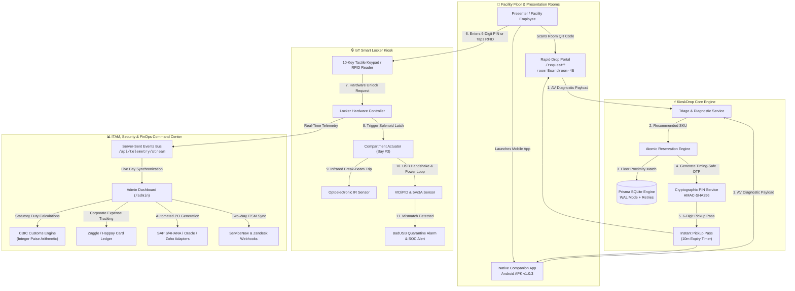

<div align="center">

# ⚡ KioskDrop Enterprise™
### Autonomous Hardware Micro-Logistics & Smart Locker Orchestration Platform

[](https://github.com/AgrShubham/kioskdrop-enterprise)
[](https://nextjs.org/)
[](https://www.typescriptlang.org/)
[](https://www.prisma.io/)
[](https://vitest.dev/)
[](https://github.com/)
[](https://www.cbic.gov.in/)

<br/>

**Eliminating "last-meter" corporate boardroom Audio/Visual (AV) failures through sub-60-second autonomous hardware distribution, distributed IoT smart lockers, zero-trust hardware whitelisting, and automated statutory FinOps micro-logistics.**

[Executive Summary](#-executive-summary) •
[System Architecture](#-system-architecture) •
[Platform Ecosystem](#-platform-ecosystem) •
[Engineering Standards](#-engineering--mathematical-rigor) •
[Quick Start](#-quick-start) •
[Deployment Guide](#-production-deployment-guide) •
[Architecture Decisions](#-architecture-decision-records-adrs)

</div>

---

> [!IMPORTANT]
> **Enterprise Release v1.0.3 Live:** KioskDrop Enterprise v1.0.3 introduces full mobile-web design parity, an interactive Quick-Switch Auth Modal with multi-role identity management, a kinetic web splash bootloader with audio feedback, universal light/dark semantic theming, and direct distribution of the native Android Companion APK (`public/downloads/kioskdrop-companion-v1.0.3.apk`).

> [!NOTE]
> **Operational Posture Notice (ADR D1):** KioskDrop Enterprise is architected as a **Production-Quality Enterprise Simulator & Reference Architecture**. Core business logic, mathematical customs duty models, pure state machines, optimistic concurrency control, and zero-trust asset tracking are fully implemented and verified with automated test suites. External enterprise ecosystems (ServiceNow/Zendesk webhooks, Happay/Zaggle corporate cards, SAP/Oracle/Zoho ERP, and WPC/BIS lookups) interface through clean adapter boundaries with labeled, authentic simulations.

---

## 📋 Table of Contents
- [Executive Summary](#-executive-summary)
- [Enterprise Problem Statement](#-the-enterprise-problem)
- [System Architecture](#-system-architecture)
- [Platform Ecosystem](#-platform-ecosystem)
  - [1. Rapid-Drop Employee Portal (`/request`)](#1-rapid-drop-employee-portal-request)
  - [2. IoT Smart Locker Simulator (`/kiosk-simulator`)](#2-iot-smart-locker-simulator-kiosk-simulator)
  - [3. ITAM, Security & FinOps Command Center (`/admin`)](#3-itam-security--finops-command-center-admin)
  - [4. Mobile Companion Application (Android)](#4-mobile-companion-application-android)
- [Engineering & Mathematical Rigor](#-engineering--mathematical-rigor)
  - [1. Statutory Customs Duty Engine (Integer Paise)](#1-statutory-customs-duty-engine-integer-paise)
  - [2. Concurrency & Race-Condition Resistance](#2-concurrency--race-condition-resistance)
  - [3. Cryptographic Timing-Attack Resistance](#3-cryptographic-timing-attack-resistance)
  - [4. Cryptographic Custody Ledger (SHA-256)](#4-cryptographic-custody-ledger-sha-256)
- [Pre-Seeded Corporate Personas](#-pre-seeded-corporate-personas)
- [Repository Structure](#-repository-structure)
- [Quick Start](#-quick-start)
- [Production Deployment Guide](#-production-deployment-guide)
- [Quality Assurance & Verification](#-quality-assurance--verification)
- [API Specification](#-api-specification)
- [Architecture Decision Records (ADRs)](#-architecture-decision-records-adrs)

---

## 🏢 Executive Summary

In global enterprise facilities, **boardroom AV and presentation connectivity disruptions** cost organizations thousands of executive hours annually:
1. **The "Last-Meter" Presentation Failure**: Missing 4K HDMI adapters, incompatible USB-C dongles, frayed cables, or dead presentation clickers delay high-stakes client meetings by 10–15 minutes on average.
2. **IT Dispatch Inefficiency**: Manual IT helpdesk tickets take 15–30 minutes for dispatch, turning simple peripheral failures into boardroom crises.
3. **Hardware-Level Security Vulnerabilities**: Unmanaged "found" or external dongles introduced into meeting rooms introduce severe keystroke injection and BadUSB firmware attack vectors.
4. **Shrinkage & Uncontrolled Asset Bleed**: Peripherals routinely walk out of conference facilities without accountability, incurring significant recurring replacement costs.
5. **Cross-Border Procurement & Customs Overhead**: Procuring certified enterprise hardware incurs multi-tier statutory duties (Basic Customs Duty, Social Welfare Surcharge, IGST) and corporate card reconciliation friction.

**KioskDrop Enterprise resolves this through distributed IoT smart locker towers**, providing automated symptom diagnosis, atomic hardware reservation in under 60 seconds, zero-trust hardware identity verification, and automated statutory procurement.

---

## 🏗️ System Architecture



---

## 🌐 Platform Ecosystem

### 1. Rapid-Drop Employee Portal (`/request`)
* **Context-Aware QR Resolution**: Automatically captures meeting room name, tower floor, and connected display types via query parameter binding (`?room=Boardroom-4B&floor=4`).
* **Interactive Diagnostic Matrix**: Instant triage for top presentation failure modes:
  * MacBook / Ultra-thin USB-C to 4K HDMI
  * Surface Mini-DisplayPort to HDMI
  * Presentation Clicker with dead AAA battery
  * Frayed or damaged HDMI display cable
  * Multi-port USB expansion hub
* **Port Damage Protocol**: Allows employees to flag damaged physical wall-plates or tabletop display ports, immediately provisioning an alternate wireless adapter while dispatching a priority ServiceNow ticket.
* **Instant Pickup Pass**: High-visibility 6-digit cryptographic PIN, assigned locker bay, floor directions, and an animated 10-minute expiry countdown.

### 2. IoT Smart Locker Simulator (`/kiosk-simulator`)
* **12-Bay Micro-Logistics Visualizer**: Real-time interactive model of physical smart locker towers with dual-state solenoid latch animations and color-coded bay status badges.
* **Tactile Multi-Modal Authentication**: Authenticate via a 10-key numeric keypad (featuring progressive rate-limiting after 5 invalid attempts) or simulated 13.56 MHz NFC employee badge tap.
* **Multi-Sensor Hardware Emulation**:
  * *Optoelectronic IR Break-Beam:* Detects physical item removal and door closure.
  * *USB VID/PID Handshake & 5V/3A Power Loop:* Confirms authentic returned hardware and verifies battery charging continuity.
  * *BadUSB Intrusion Quarantine:* Simulates counterfeit or compromised hardware insertion, locking the bay into `SECURITY_MISMATCH_ALARM` with automated SOC notification.

### 3. ITAM, Security & FinOps Command Center (`/admin`)
* **Zero-Trust Hardware Whitelist**: Enterprise control over approved USB Vendor IDs (VID), Product IDs (PID), WPC ETA certificates, and BIS CRS registration numbers. Non-whitelisted peripherals are isolated automatically.
* **Statutory Indian Customs Landed Cost Engine**: Full compliance with CBIC notification No. 50/2017 & Section 14 of the Customs Act. Implements exact integer-paise calculations for Assessable Value ($1.01 \times CIF$), Basic Customs Duty ($20\%$), Social Welfare Surcharge ($10\%$ of BCD), and IGST ($18\%$).
* **Autonomous FinOps & Corporate Prepaid Cards**: Live ledger tracking Zaggle and Happay corporate expense card balances, transaction audit logs, and automated restock purchase order creation integrated into SAP S/4HANA, Oracle NetSuite, and Zoho Books formats.
* **Consumption Anomaly Detection**: Automated heuristic engine continuously monitoring meeting room checkouts, actively flagging rooms consuming $\ge 4$ unreturned peripherals in a 10-day window (e.g., pre-seeded `Boardroom-4B` anomaly).
* **Enterprise Webhook Gateway & Replay**: Live stream of inbound and outbound webhook events for ServiceNow and Zendesk with one-click dead-letter replay capability.

### 4. Mobile Companion Application (Android)
* **Native Architecture**: Standalone Kotlin/Jetpack Compose mobile client providing on-the-go AV triage, real-time ticket tracking, and QR code badge scanning.
* **Offline-Resilient PIN Storage**: Locally stores active pickup passes with encrypted storage so employees can retrieve gear even in network-dead zones.
* **Direct APK Distribution**: Direct download link available in the web portal and distributed from `/downloads/kioskdrop-companion-v1.0.3.apk`.

---

## 🔬 Engineering & Mathematical Rigor

### 1. Statutory Customs Duty Engine (Integer Paise)

To ensure zero floating-point imprecision in financial transactions, all monetary figures are computed strictly in **integer paise** ($1 \text{ INR} = 100 \text{ paise}$):

$$\text{Assessable Value } (V_a) = \left\lfloor V_{\text{CIF}} \times 1.01 + 0.5 \right\rfloor$$
$$\text{Basic Customs Duty } (\text{BCD}) = \left\lfloor V_a \times 0.20 + 0.5 \right\rfloor$$
$$\text{Social Welfare Surcharge } (\text{SWS}) = \left\lfloor \text{BCD} \times 0.10 + 0.5 \right\rfloor$$
$$\text{Integrated GST } (\text{IGST}) = \left\lfloor (V_a + \text{BCD} + \text{SWS}) \times 0.18 + 0.5 \right\rfloor$$
$$\text{Total Customs Duty} = \text{BCD} + \text{SWS} + \text{IGST} = 44.40\% \text{ of } V_{\text{CIF}}$$

#### Golden Test Vectors (Verified in `test/landed-cost.test.ts`):
| Metric | Golden Vector A (Paise) | Golden Vector B (Paise) |
| :--- | :--- | :--- |
| **CIF Value** | ₹1,000.00 (`100,000`) | ₹34,000.00 (`3,400,000`) |
| **Assessable Value ($V_a$)** | ₹1,010.00 (`101,000`) | ₹34,340.00 (`3,434,000`) |
| **Basic Customs Duty (BCD 20%)** | ₹202.00 (`20,200`) | ₹6,868.00 (`686,800`) |
| **Social Welfare Surcharge (SWS 10%)**| ₹20.20 (`2,020`) | ₹686.80 (`68,680`) |
| **IGST (18%)** | ₹221.80 (`22,180`) | ₹7,541.06 (`754,106`) |
| **Total Customs Duty** | **₹444.00** (`44,400`) | **₹15,095.86** (`1,509,586`) |
| **Total Landed Cost** | **₹1,444.00** (`144,400`) | **₹49,095.86** (`4,909,586`) |

---

### 2. Concurrency & Race-Condition Resistance

To prevent double-reservations under peak load (e.g., 20 simultaneous requests for the last remaining USB-C adapter), KioskDrop utilizes **Atomic Conditional Database Updates** with exponential jitter retry backoff:

```typescript
// Atomic reservation pattern in src/services/reservation.ts
const updated = await tx.lockerCompartment.updateMany({
  where: {
    id: candidateCompartment.id,
    state: "STOCKED_AVAILABLE", // State must match at exact instant of write
  },
  data: {
    state: "RESERVED",
    updatedAt: new Date(),
  },
});

if (updated.count !== 1) {
  // Another thread claimed this bay milliseconds prior -> retry candidate search
  continue;
}
```

* **Verified in `test/concurrency.test.ts`**: 20 asynchronous worker threads compete concurrently for a single available bay. **Result: Exactly 1 reservation succeeds; 19 gracefully return `NoStockAvailableError`; 0 orphaned records created.**

---

### 3. Cryptographic Timing-Attack Resistance

Standard string comparison (`===`) leaks execution timing information through early byte termination. KioskDrop protects PIN verification using HMAC-SHA256 hashing and constant-time buffer equality checks:

```typescript
// Constant-time comparison in src/services/pin.ts
export function verifyPinConstantTime(inputPin: string, storedHash: string, salt: string): boolean {
  const inputHash = hashPin(inputPin, salt);
  const bufA = Buffer.from(inputHash, "utf-8");
  const bufB = Buffer.from(storedHash, "utf-8");

  if (bufA.length !== bufB.length) return false;
  return crypto.timingSafeEqual(bufA, bufB);
}
```

---

### 4. Cryptographic Custody Ledger (SHA-256)

Every custody transition (Reservation $\rightarrow$ Solenoid Open $\rightarrow$ IR Break-Beam Trip $\rightarrow$ Return Probe $\rightarrow$ Restock) generates an immutable ledger entry cryptographically linked to the preceding record:

$$H_n = \text{SHA-256}(H_{n-1} \,\|\, \text{ticketId} \,\|\, \text{action} \,\|\, \text{actorId} \,\|\, \text{timestamp})$$

Any manual tampering with historical database records invalidates the hash chain across all subsequent custody events.

---

## 👥 Pre-Seeded Corporate Personas

Switch personas dynamically using the **Quick-Switch Identity Modal** in the top navigation bar or visiting `/login`:

| Persona Name | Role | Primary Objective / Interface |
| :--- | :--- | :--- |
| **Aarav Sharma** | `EMPLOYEE` | Rapid AV diagnosis, meeting room requests, 6-digit pickup pass retrieval. |
| **Priya Patel** | `IT_ADMIN` | Fleet management, USB whitelist control, BadUSB alarms, reception returns. |
| **Vikram Malhotra** | `FINOPS_AUDITOR` | Statutory customs duties, prepaid cards (Zaggle/Happay), ERP PO generation. |
| **Security Operations** | `SECURITY_OFFICER` | Zero-trust compliance audit, WPC/BIS verification, intrusion forensics. |

---

## 📁 Repository Structure

```
kioskdrop-enterprise/
├── brand-assets/                  # Official SVG logos, mobile icons, brand guideline JSON
├── docs/
│   ├── BUSINESS_DECK.md           # Executive business deck and enterprise ROI analysis
│   ├── DECISIONS.md               # Formal Architecture Decision Records (ADR D1 - D6)
│   ├── DEPLOYMENT_GUIDE.md        # Comprehensive multi-cloud production deployment guide
│   ├── MOBILE_APP_USER_GUIDE.md   # Android Companion Application manual & release notes
│   └── SECURITY_AUDIT_EXCEPTIONS.md # Security compliance documentation & mitigation log
├── prisma/
│   ├── schema.prisma              # Production SQLite schema (WAL mode, integer paise)
│   ├── seed.ts                    # Enterprise seed (24 bays, 7 SKUs, 4 rooms, anomalies)
│   └── migrations/                # Version-controlled database migrations
├── public/
│   ├── downloads/                 # Native Android APK binary distribution point
│   ├── sounds/                    # Kinetic audio sound-effects (unlock, scan, success)
│   └── favicon.ico                # Multi-resolution enterprise brand icon
├── scripts/
│   ├── audit-ui-and-theme.js      # Headless Playwright UI and theme verification script
│   ├── record-synced-video.js     # Automated presentation video recorder with audio muxing
│   └── generate-synced-voiceover.py # Neural TTS voiceover generator for platform demos
├── src/
│   ├── app/
│   │   ├── admin/page.tsx         # Enterprise ITAM, Compliance & FinOps Command Center
│   │   ├── kiosk-simulator/page.tsx # 12-bay physical smart locker simulator
│   │   ├── login/page.tsx         # Multi-role authentication & identity switcher
│   │   ├── request/page.tsx       # Rapid-drop employee triage & QR reservation view
│   │   ├── page.tsx               # Enterprise landing portal & platform showcase
│   │   └── api/                   # Typed Next.js Route Handlers
│   ├── components/                # Modular UI components (Navbar, Modals, Splash)
│   ├── domain/                    # Pure deterministic state machines (Compartment, Ticket)
│   ├── hooks/                     # Custom hooks (useTelemetry SSE subscriber)
│   ├── lib/                       # Prisma client singleton, Telemetry Event Bus
│   └── services/                  # Business services (Landed Cost, Concurrency, PIN, Triage)
├── test/                          # Comprehensive Vitest test suite (44/44 passing)
├── tailwind.config.js             # Semantic color tokens and responsive breakpoints
├── tsconfig.json                  # Strict TypeScript configuration
└── package.json                   # Pinned dependency manifest
```

---

## 🚀 Quick Start

### Prerequisites
* **Node.js**: `>= 18.18.0` (Verified on Node.js `v20.x` LTS and `v22.x`)
* **npm**: `>= 9.0.0`

### 1. Clone & Install
```bash
git clone https://github.com/AgrShubham/kioskdrop-enterprise.git
cd kioskdrop-enterprise
npm install
```

### 2. Environment Setup
```bash
cp .env.example .env
```
*(Default settings utilize local SQLite WAL engine `file:./dev.db` with pre-configured HMAC secrets).*

### 3. Database Initialization & Seeding
```bash
# Apply database migrations
npx prisma migrate dev --name init

# Seed SKUs, Smart Lockers, Meeting Rooms, Personas, and FinOps Anomalies
npm run db:seed
```

### 4. Launch Development Server
```bash
npm run dev
```
Open **[http://localhost:3000](http://localhost:3000)** in your browser.

---

## 🚢 Production Deployment Guide

KioskDrop Enterprise uses a **Stateful Node.js Runtime** (ADR D3) to maintain persistent Server-Sent Events (SSE) subscriptions and low-latency SQLite WAL concurrency.

### Option 1: Docker & Docker Compose (Recommended)
The repository contains an optimized multi-stage `Dockerfile` and `docker-compose.yml`:

```bash
# Build and run containerized service
docker compose up -d --build
```
* Persistent storage is mapped to the `kioskdrop_enterprise_db` Docker volume.
* Access the running service at `http://<your-server-ip>:3000`.

### Option 2: 1-Click Cloud PaaS (Railway / Render)
1. Link your GitHub repository to [Railway.app](https://railway.app/) or [Render.com](https://render.com/).
2. Attach a **Persistent Disk** mounted at `/app/prisma` (1 GB size recommended).
3. Set environment variables:
   * `NODE_ENV=production`
   * `DATABASE_URL=file:/app/prisma/dev.db`
   * `PIN_HMAC_SECRET=<your-random-32-char-secret>`
4. Deploy service via standard Docker container build.

---

## 🧪 Quality Assurance & Verification

KioskDrop Enterprise enforces strict quality gates across every commit:

```bash
# 1. Typecheck strict TypeScript
npm run typecheck

# 2. Code style and linting
npm run lint

# 3. Comprehensive test suite
npm run test

# 4. Production build validation
npm run build
```

### Test Suite Execution Summary (`npm run test`)
```text
 ✓ test/api-integration.test.ts (10 tests)
 ✓ test/concurrency.test.ts (1 test - 20 parallel workers)
 ✓ test/kiosk.test.ts (5 tests)
 ✓ test/states.test.ts (8 tests)
 ✓ test/triage.test.ts (8 tests)
 ✓ test/landed-cost.test.ts (3 tests)
 ✓ test/web-auth-rbac.test.ts (4 tests)
 ✓ test/pin.test.ts (4 tests)
 ✓ test/web-splash.test.ts (1 test)

 Test Files  9 passed (9)
      Tests  44 passed (44)
   Duration  9.53s
```

---

## 📡 API Specification

| Endpoint | Method | Role | Description |
| :--- | :--- | :--- | :--- |
| `/api/diagnose-and-reserve` | `POST` | Any | Diagnose AV issue, execute atomic reservation, issue 6-digit OTP. |
| `/api/kiosk/authenticate-and-unlock` | `POST` | Any | Authenticate PIN or RFID card, actuate solenoid latch. |
| `/api/kiosk/remove-asset` | `POST` | Any | Simulate optoelectronic IR break-beam sensor checkout. |
| `/api/kiosk/return-asset` | `POST` | Any | Simulate asset return with USB VID/PID probe and charging check. |
| `/api/kiosk/report-foreign-device` | `POST` | Any | Trigger BadUSB alarm and lock bay into quarantine. |
| `/api/telemetry/stream` | `GET` | Any | Real-time Server-Sent Events (SSE) telemetry bus. |
| `/api/admin/compliance` | `GET/POST`| `IT_ADMIN` | Manage USB whitelist and view regulatory equipment certificates. |
| `/api/admin/compliance/landed-cost` | `POST` | `FINOPS` | Compute statutory Indian customs duty in integer paise. |
| `/api/admin/finops` | `GET/POST`| `FINOPS` | View corporate card ledgers and transmit restock PO to ERP. |
| `/api/admin/analytics` | `GET` | `IT_ADMIN` | Calculate meeting room consumption anomalies and floor metrics. |
| `/api/admin/reception/scan` | `POST` | `IT_ADMIN` | Reception desk barcode scanner for manual asset return intake. |
| `/api/admin/webhooks` | `POST` | `IT_ADMIN` | Replay dead-letter ServiceNow or Zendesk webhook events. |

---

## 🏛️ Architecture Decision Records (ADRs)

Detailed records are maintained in [docs/DECISIONS.md](docs/DECISIONS.md):

* **ADR D1: Enterprise Simulator Posture** — External systems (ServiceNow, SAP, WPC) interface via strictly typed adapter interfaces with authentic mock services to enable deterministic, zero-dependency testing.
* **ADR D2: Integer Paise Currency Representation** — Floating-point representations (`FLOAT`/`REAL`) are strictly banned for monetary amounts to satisfy statutory audit standards. All financial ledger figures are stored in integer paise.
* **ADR D3: Pure In-Memory State Machines** — Compartment and Ticket lifecycle transitions are isolated as pure functions returning immutable state objects or throwing explicit domain errors.
* **ADR D4: Server-Sent Events (SSE) for Telemetry** — Stateful SSE Route Handlers (`/api/telemetry/stream`) provide sub-second live synchronization with 15s heartbeats, avoiding WebSocket infrastructure overhead.
* **ADR D5: Cryptographic PIN & Timing Resistance** — Node.js `crypto.randomInt` and `crypto.timingSafeEqual` with rate-limiting lockouts prevent brute-force and side-channel timing attacks.
* **ADR D6: SQLite WAL Mode with Concurrency Retries** — SQLite configured with Write-Ahead Logging (`WAL`), `busy_timeout = 10000;`, and exponential jitter retry wrappers (`withSqliteRetry`) to guarantee robust concurrent write throughput.

---

<div align="center">

**KioskDrop Enterprise™ — Autonomous Hardware Micro-Logistics Platform**  
Designed and engineered for zero-downtime enterprise presentation facilities.

[Back to Top ↑](#-kioskdrop-enterprise)

</div>
