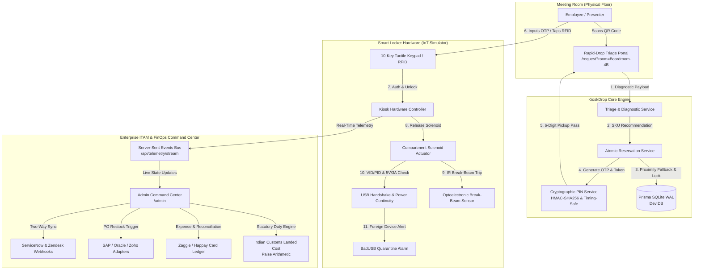

<div align="center">

# ⚡ KioskDrop Enterprise
### Automated Conference & Presentation Kit Smart-Locker & Micro-Logistics Platform

[](https://nextjs.org/)
[](https://react.dev/)
[](https://www.typescriptlang.org/)
[](https://www.prisma.io/)
[](https://tailwindcss.com/)
[](https://vitest.dev/)
[](https://github.com/)
[](LICENSE)

<br/>

**Eliminating "last-meter" corporate boardroom Audio/Visual (AV) failures through autonomous hardware triage, distributed IoT smart lockers, zero-trust hardware whitelisting, and FinOps micro-logistics.**

[Explore Architecture](#-system-architecture) •
[Quick Start](#-quick-start) •
[Operational Views](#-core-operational-views) •
[Engineering Standards](#-engineering--mathematical-rigor) •
[API Reference](#-api-specification) •
[Decision Records](#-architecture-decision-records-adrs)

</div>

---

> [!TIP]
> **🚀 Vercel Serverless Branch:** This branch is specifically engineered for **100% Free Vercel Serverless Deployment** with automated PostgreSQL schema adaptation ([Neon.tech](https://neon.tech/) / [Vercel Postgres](https://vercel.com/docs/storage/vercel-postgres)), Vercel Cron reservation sweepers (`/api/cron/sweep`), and client-side `BroadcastChannel` synchronization.
> *Looking for the Docker & VPS reference architecture? Switch to the [`main`](https://github.com/AgrShubham/kioskdrop-enterprise/tree/main) branch.*

> [!NOTE]
> **Operational Posture Notice (ADR D1):** KioskDrop Enterprise is architected as a **Production-Quality Enterprise Simulator & Reference Architecture**. Core business logic, mathematical customs duty models, pure state machines, optimistic concurrency control, and zero-trust asset tracking are fully implemented and verified with automated test suites. External enterprise ecosystems (ServiceNow/Zendesk webhooks, Happay/Zaggle corporate cards, SAP/Oracle/Zoho ERP, and WPC/BIS lookups) interface through clean adapter boundaries with labeled, authentic simulations.

---

## 📋 Table of Contents
- [Executive Problem Statement](#-executive-problem-statement)
- [System Architecture](#-system-architecture)
- [Core Operational Views](#-core-operational-views)
- [Key Features](#-key-features)
- [Engineering & Mathematical Rigor](#-engineering--mathematical-rigor)
  - [Statutory Customs Duty Engine (Integer Paise)](#1-statutory-customs-duty-engine-integer-paise)
  - [Concurrency & Race-Condition Resistance](#2-concurrency--race-condition-resistance)
  - [Cryptographic PIN Security & Timing Resistance](#3-cryptographic-pin-security--timing-resistance)
  - [Tamper-Evident Custody Chain (SHA-256)](#4-tamper-evident-custody-chain-sha-256)
- [Repository Structure](#-repository-structure)
- [Quick Start](#-quick-start)
- [Quality Gates & Verification](#-quality-gates--verification)
- [API Specification](#-api-specification)
- [Architecture Decision Records (ADRs)](#-architecture-decision-records-adrs)

---

## 🎯 Executive Problem Statement

In enterprise corporate facilities, **boardroom AV and presentation connectivity failures** cost organizations thousands of executive hours annually:
1. **The "Last-Meter" Dongle Crisis**: Incompatible USB-C ports, damaged display cords, absent 4K HDMI adapters, or dead clicker batteries cause 10–15 minute delays at the start of high-stakes presentations.
2. **IT Support Bottlenecks**: Helpdesk dispatch takes 15–30 minutes, turning minor peripheral issues into critical meeting disruptions.
3. **Cybersecurity Threats (BadUSB)**: Unmanaged "found" or counterfeit dongles brought in from external sources introduce keystroke injection and hardware-level malware risks.
4. **Uncontrolled Shrinkage & Inventory Bleed**: AV adapters routinely walk out of meeting rooms with visiting clients or employees, disappearing into personal laptop bags with zero accountability.
5. **FinOps & Customs Complications**: Procuring enterprise-certified AV peripherals across international borders incurs complex statutory duties (BCD, SWS, IGST) and corporate expense card reconciliation friction.

**KioskDrop Enterprise solves this with sub-60-second autonomous hardware distribution**, placing secure, IoT-connected smart lockers on each office floor backed by zero-trust cybersecurity whitelists and autonomous ERP procurement.

---

## 🏗️ System Architecture



---

## 🖥️ Core Operational Views

### 1. Rapid-Drop Employee Triage Portal (`/request`)
* **Room-Aware Context**: Instantly detects room name, floor location, and installed AV display equipment via QR parameter binding (`?room=Boardroom-4B&floor=4`).
* **Symptom-Driven Diagnosis**: Curated triage decision matrix resolving 5 core presentation failure modes (MacBook USB-C to HDMI, Surface Mini-DP, dead presentation clicker, frayed cable, missing USB-A hub).
* **Port Damage Override**: Flag damaged boardroom ports to trigger an automated ServiceNow priority ticket while simultaneously provisioning an alternate adapter.
* **Instant Pickup Pass**: Displays the designated smart locker floor, bay number, animated 10-minute expiry countdown timer, and high-visibility 6-digit cryptographic OTP.

### 2. Interactive IoT Smart Locker Simulator (`/kiosk-simulator`)
* **12-Bay Micro-Logistics Visualizer**: Real-time rendering of physical compartments across tower floors with dual-state solenoid latch animations.
* **Multi-Modal Authentication**: Dual-mode entry via tactile 10-key numeric PIN pad (with rate-limiting lockout after 5 consecutive failed attempts) and simulated 13.56MHz NFC employee badge tap.
* **Hardware Sensor Emulation**:
  * *IR Break-Beam Sensor:* Simulates optoelectronic beam interruption when an employee removes an asset.
  * *USB VID/PID Handshake & 5V/3A Power Loop:* Verifies genuine hardware identity and active charging continuity upon return.
  * *BadUSB Intrusion Quarantine:* Simulates counterfeit or malicious hardware insertion, locking the bay into `SECURITY_MISMATCH_ALARM` with audible warning and immediate SOC dispatch.

### 3. ITAM, Zero-Trust Compliance & FinOps Command Center (`/admin`)
* **Zero-Trust Compliance Whitelist**: Direct management of approved USB Vendor IDs (VID), Product IDs (PID), WPC ETA certificates, and BIS CRS registration numbers. Toggleable quarantine switches isolate uncertified hardware.
* **Statutory Indian Customs Landed Cost Engine**: Full compliance with CBIC notification No. 50/2017 & Section 14 of the Customs Act. Implements integer-paise calculations for Assessable Value ($1.01 \times CIF$), Basic Customs Duty ($20\%$), Social Welfare Surcharge ($10\%$ of BCD), and IGST ($18\%$).
* **Autonomous FinOps & Corporate Prepaid Cards**: Live ledger tracking Zaggle and Happay corporate expense card balances, transaction audit logs, and automated restock purchase order creation integrated into SAP S/4HANA, Oracle NetSuite, and Zoho Books formats.
* **Consumption Anomaly Detection**: Automated heuristic engine continuously monitoring meeting room checkouts, actively flagging rooms consuming $\ge 4$ unreturned peripherals in a 10-day window (e.g., pre-seeded `Boardroom-4B` anomaly).
* **Enterprise Webhook Gateway & Replay**: Live stream of inbound and outbound webhook events for ServiceNow and Zendesk with one-click dead-letter replay capability.

---

## ✨ Key Features

| Capability | Specification | Implementation Highlight |
| :--- | :--- | :--- |
| **Atomic Concurrency** | Zero double-reservations under load | Conditional `prisma.lockerCompartment.updateMany` with `count === 1` check |
| **Proximity Fallback** | Nearest-floor locker resolution | Cascading radius scan: same floor $\rightarrow$ adjacent floors $\rightarrow$ tower-wide |
| **Tamper-Evident Audit** | Cryptographic custody logging | SHA-256 hash chaining ($H_n = \text{SHA256}(H_{n-1} + \dots)$) across all movements |
| **Real-Time Telemetry** | Sub-second bay synchronization | Stateful SSE stream (`/api/telemetry/stream`) with 15s heartbeats & client auto-reconnect |
| **Statutory Duty Math** | Round-half-up integer paise | $44.40\%$ total duty on CIF with zero floating-point precision error |
| **Security Posture** | Timing-attack resistant auth | Node.js `crypto.timingSafeEqual` over HMAC-SHA256 digests with salt |

---

## 🔬 Engineering & Mathematical Rigor

### 1. Statutory Customs Duty Engine (Integer Paise)

To completely eliminate IEEE 754 floating-point inaccuracies in financial calculations, all monetary values are stored and calculated strictly in **integer paise** ($1 \text{ INR} = 100 \text{ paise}$).

Under the Indian Customs Act (Section 14) and Finance Act 2018:
1. **Landing Charges**: Assessed at $1\%$ of CIF value:
   $$V_a = \left\lfloor V_{\text{CIF}} \times 1.01 + 0.5 \right\rfloor$$
2. **Basic Customs Duty (BCD)**: $20\%$ of Assessable Value ($V_a$):
   $$\text{BCD} = \left\lfloor V_a \times 0.20 + 0.5 \right\rfloor$$
3. **Social Welfare Surcharge (SWS)**: $10\%$ of BCD:
   $$\text{SWS} = \left\lfloor \text{BCD} \times 0.10 + 0.5 \right\rfloor$$
4. **Integrated Goods & Services Tax (IGST)**: $18\%$ on $(V_a + \text{BCD} + \text{SWS})$:
   $$\text{IGST} = \left\lfloor (V_a + \text{BCD} + \text{SWS}) \times 0.18 + 0.5 \right\rfloor$$
5. **Total Duty Payable**: $\text{BCD} + \text{SWS} + \text{IGST} = 44.40\% \text{ of } V_{\text{CIF}}$. *(Note: IGST is recoverable as Input Tax Credit (ITC) for GST-registered entities).*

#### Automated Golden Vectors (Verified in `test/landed-cost.test.ts`):
* **Vector A (CIF ₹1,000 / 100,000 paise)**:
  * Assessable Value: ₹1,010.00
  * BCD ($20\%$): ₹202.00
  * SWS ($10\%$ of BCD): ₹20.20
  * IGST ($18\%$): ₹221.80
  * **Total Customs Duties:** ₹444.00 (exactly $44.40\%$ of CIF)
  * **Total Landed Cost:** ₹1,444.00
* **Vector B (CIF ₹34,000 / 3,400,000 paise)**:
  * Assessable Value: ₹34,340.00
  * BCD ($20\%$): ₹6,868.00
  * SWS ($10\%$): ₹686.80
  * IGST ($18\%$): ₹7,541.06
  * **Total Customs Duties:** ₹15,095.86
  * **Total Landed Cost:** ₹49,095.86

---

### 2. Concurrency & Race-Condition Resistance

Smart locker compartments represent scarce physical assets. If 20 employees simultaneously request the last remaining USB-C dongle on Floor 4, standard read-then-write patterns result in disastrous double-booking.

KioskDrop solves this through **Atomic Conditional Database Updates** combined with exponential retry backoff:

```typescript
// Atomic reservation pattern in src/services/reservation.ts
const updated = await tx.lockerCompartment.updateMany({
  where: {
    id: candidateCompartment.id,
    state: "STOCKED_AVAILABLE", // State must match at exact instant of write
  },
  data: {
    state: "RESERVED",
    updatedAt: new Date(),
  },
});

if (updated.count !== 1) {
  // Another thread claimed this bay milliseconds prior -> retry candidate search
  continue;
}
```

* **Verified via Vitest (`test/concurrency.test.ts`)**: 20 asynchronous worker threads simultaneously contend for 1 available item. **Result: Exactly 1 reservation succeeds; 19 gracefully receive `NoStockAvailableError`; 0 orphaned records created.**

---

### 3. Cryptographic PIN Security & Timing Resistance

Standard string comparisons (`===`) leak timing information through early string termination, exposing the system to side-channel attacks:

```typescript
// Constant-time HMAC comparison in src/services/pin.ts
export function verifyPinConstantTime(inputPin: string, storedHash: string, salt: string): boolean {
  const inputHash = hashPin(inputPin, salt);
  const bufA = Buffer.from(inputHash, "utf-8");
  const bufB = Buffer.from(storedHash, "utf-8");

  if (bufA.length !== bufB.length) return false;
  return crypto.timingSafeEqual(bufA, bufB);
}
```
* **Brute-Force Protection**: Keypad authentications are rate-limited. 5 consecutive incorrect attempts permanently lock out the ticket, requiring administrator intervention.

---

### 4. Tamper-Evident Custody Chain (SHA-256)

Every custody transition (Reservation $\rightarrow$ Solenoid Open $\rightarrow$ IR Break-Beam Trip $\rightarrow$ Return Probe $\rightarrow$ Restock) generates an immutable ledger entry cryptographically linked to the preceding record:

$$H_n = \text{SHA-256}(H_{n-1} \,\|\, \text{ticketId} \,\|\, \text{action} \,\|\, \text{actorId} \,\|\, \text{timestamp})$$

Any manual tampering with historical database records invalidates the hash chain across all subsequent custody events.

---

## 📁 Repository Structure

```
kioskdrop-enterprise/
├── prisma/
│   ├── schema.prisma              # SQLite schema (WAL mode, integer paise, relations)
│   ├── seed.ts                    # Enterprise seed (24 bays, 7 SKUs, 4 rooms, anomalies)
│   └── migrations/                # Version-controlled SQL migration history
├── src/
│   ├── app/
│   │   ├── page.tsx               # Enterprise landing portal & architecture overview
│   │   ├── layout.tsx             # Root layout with responsive Navbar and Theme tokens
│   │   ├── request/page.tsx       # Employee QR triage & fast-track reservation view
│   │   ├── kiosk-simulator/page.tsx # 12-bay physical locker & IoT hardware simulator
│   │   ├── admin/page.tsx         # ITAM, Whitelist, Landed-Cost & FinOps command center
│   │   └── api/
│   │       ├── diagnose-and-reserve/route.ts  # Triage diagnostic & atomic booking API
│   │       ├── kiosk/
│   │       │   ├── authenticate-and-unlock/   # PIN/RFID validation & solenoid trigger
│   │       │   ├── remove-asset/              # IR break-beam sensor checkout trigger
│   │       │   ├── return-asset/              # VID/PID probe & power continuity check
│   │       │   └── report-foreign-device/     # BadUSB alarm & quarantine controller
│   │       ├── lockers/route.ts               # Real-time locker & compartment query API
│   │       ├── rooms/route.ts                 # Meeting room directory query API
│   │       ├── session/                       # Role switcher & session cookies
│   │       ├── telemetry/stream/route.ts      # Real-Time SSE Route Handler
│   │       ├── admin/
│   │       │   ├── compliance/                # Whitelist management & Landed-Cost API
│   │       │   ├── finops/                    # Prepaid card ledger & restock PO API
│   │       │   ├── analytics/                 # Anomaly detection & floor metrics API
│   │       │   ├── reception/scan/            # Reception asset return scanning API
│   │       │   └── webhooks/                  # Webhook log & replay API
│   │       └── webhooks/                      # Inbound ServiceNow/Zendesk endpoints
│   ├── domain/
│   │   └── states.ts              # Pure state machines for Compartments & Tickets
│   ├── lib/
│   │   ├── prisma.ts              # Prisma singleton with WAL initialization
│   │   └── telemetry-bus.ts       # In-memory pub/sub telemetry event broadcaster
│   ├── services/
│   │   ├── landed-cost.ts         # Statutory Indian customs duty engine (paise)
│   │   ├── pin.ts                 # Cryptographic OTP & timing-safe verification
│   │   ├── triage.ts              # Room-aware symptom diagnostic engine
│   │   ├── reservation.ts         # Atomic reservation & proximity fallback engine
│   │   └── kiosk.ts               # Physical locker hardware actuation services
│   ├── components/
│   │   └── Navbar.tsx             # Universal navigation bar with live SSE indicator
│   └── hooks/
│       └── useTelemetry.ts        # Client-side SSE event subscription hook
├── test/
│   ├── states.test.ts             # State machine transition unit tests
│   ├── landed-cost.test.ts        # Golden Test Vectors A & B verification
│   ├── pin.test.ts                # OTP generator & constant-time HMAC tests
│   ├── triage.test.ts             # Symptom diagnostic matrix tests
│   ├── concurrency.test.ts        # 20-worker parallel reservation race condition test
│   ├── kiosk.test.ts              # Lockout, break-beam & BadUSB sensor tests
│   └── api-integration.test.ts    # REST endpoint integration tests
├── docs/
│   ├── DECISIONS.md               # Architecture Decision Records (ADRs D1-D6)
│   └── SECURITY_AUDIT_EXCEPTIONS.md # Security audit justification & mitigations
├── vitest.config.ts               # Vitest test configuration (single-thread DB mode)
├── tailwind.config.js             # Custom enterprise theme & color definitions
├── tsconfig.json                  # Strict TypeScript configuration (ES2022 target)
└── package.json                   # Pinned dependency manifest
```

---

## 🚀 Quick Start

### Prerequisites
* **Node.js**: `>= 18.18.0` (Tested on Node.js `v20.x` and `v25.x`)
* **npm**: `>= 9.0.0`

### 1. Clone & Install Dependencies
```bash
git clone https://github.com/AgrShubham/kioskdrop-enterprise.git
cd kioskdrop-enterprise
npm install
```

### 2. Environment Configuration
Create your local environment file:
```bash
cp .env.example .env
```
*(Default configuration uses local SQLite database file `file:./dev.db` with a 32-character HMAC secret).*

### 3. Initialize Database & Seed Corporate Data
```bash
# Run Prisma migrations
npx prisma migrate dev --name init

# Seed SKUs, Smart Lockers, Meeting Rooms, Personas, and Anomalies
npm run db:seed
```

### 4. Launch Development Server
```bash
npm run dev
```
Open **[http://localhost:3000](http://localhost:3000)** (or port `3001` if `3000` is active).

---

## 🚢 Deployment Guide

KioskDrop Enterprise is built on a **Stateful Node.js Runtime** (ADR D3) to maintain persistent Server-Sent Events (SSE) connections and SQLite WAL concurrency without external broker overhead.

### Option 1: Docker & Docker Compose (Recommended for Production / VPS)

The project includes an optimized multi-stage `Dockerfile` and `docker-compose.yml` with automated database migration and persistent volume storage.

1. **Clone on your server (DigitalOcean, AWS EC2, Hetzner, etc.):**
   ```bash
   git clone https://github.com/AgrShubham/kioskdrop-enterprise.git
   cd kioskdrop-enterprise
   ```

2. **Configure environment variables:**
   ```bash
   cp .env.example .env
   # Update PIN_HMAC_SECRET and NEXT_PUBLIC_APP_URL with your production domain
   ```

3. **Launch with Docker Compose:**
   ```bash
   docker compose up -d --build
   ```
   * The container automatically executes `npx prisma migrate deploy` and seeds initial SKUs on first boot.
   * SQLite data is safely persisted in the `kioskdrop_enterprise_db` Docker volume.
   * Access the application on `http://<your-server-ip>:3000`.

---

### Option 2: 1-Click Cloud PaaS (Render / Railway / Fly.io)

For zero-DevOps managed hosting with persistent volumes:

#### **A. Deploy on Railway.app**
1. Fork or open [https://github.com/AgrShubham/kioskdrop-enterprise](https://github.com/AgrShubham/kioskdrop-enterprise).
2. On [Railway.app](https://railway.app/), click **"New Project" $\rightarrow$ "Deploy from GitHub repo"** and select `kioskdrop-enterprise`.
3. Add a **Persistent Volume** mounted at `/app/prisma` to preserve the SQLite database.
4. Set Environment Variables:
   * `NODE_ENV=production`
   * `DATABASE_URL=file:/app/prisma/dev.db`
   * `PIN_HMAC_SECRET=<generate-random-32-char-secret>`
5. Railway will automatically build the `Dockerfile` and deploy the service.

#### **B. Deploy on Render.com**
1. Create a **New Web Service** and connect your GitHub repository.
2. Select **Docker** environment.
3. Attach a **Disk (Persistent Storage)**:
   * Mount Path: `/app/prisma`
   * Size: `1 GB`
4. Set environment variable `DATABASE_URL=file:/app/prisma/dev.db`.
5. Click **Create Web Service**.

---

### Option 3: 100% Free Vercel Deployment (with Vercel Postgres or Neon)

You can deploy KioskDrop Enterprise completely free on **Vercel** paired with a free cloud PostgreSQL database (via **Vercel Postgres** or **Neon.tech**).

#### **Step-by-Step Vercel Deployment:**

1. **Import Repository to Vercel**:
   * Go to [vercel.com/new](https://vercel.com/new) and import `AgrShubham/kioskdrop-enterprise`.

2. **Add Free Serverless Database**:
   * *Option A (Direct in Vercel):* Go to the **Storage** tab in your Vercel project $\rightarrow$ Click **"Create Database"** $\rightarrow$ Select **"Postgres"** (Powered by Neon, 100% free). Connect it to your project. Vercel automatically sets `POSTGRES_PRISMA_URL` and `DATABASE_URL`.
   * *Option B (Neon.tech directly):* Create a free database at [Neon.tech](https://neon.tech/) and paste the `DATABASE_URL` into your Vercel Project Environment Variables.

3. **Configure Environment Variables**:
   In your Vercel Project Settings $\rightarrow$ Environment Variables:
   * `PIN_HMAC_SECRET` = `<any-32-character-random-hex-string>`
   * `DATABASE_URL` = `<your-postgres-connection-string>`

4. **Deploy**:
   * Click **Deploy**.
   * The automated build pipeline ([scripts/prepare-build.js](file:///d:/PROJECTS/Ricoz%20Internship/Project%201/scripts/prepare-build.js)) automatically detects the PostgreSQL environment, switches Prisma to `provider = "postgresql"`, pushes the database schema, and compiles Next.js.
   * Real-time multi-tab synchronization is powered by browser `BroadcastChannel` and adaptive polling fallback.
   * Automated reservation TTL cleanup runs via [vercel.json](file:///d:/PROJECTS/Ricoz%20Internship/Project%201/vercel.json) Vercel Cron.


---

## 👤 Pre-Seeded Personas & Demo Accounts

Use the **Role Switcher** in the top navigation bar to seamlessly transition between operational personas:

| Persona Name | Role | Primary Objective / View |
| :--- | :--- | :--- |
| **Aarav Sharma** | `EMPLOYEE` | Accesses `/request` to diagnose AV issues and claim pickup passes. |
| **Priya Patel** | `IT_ADMIN` | Accesses `/admin` for USB whitelist toggles, fleet telemetry, and reception returns. |
| **Vikram Malhotra** | `FINOPS_AUDITOR` | Accesses `/admin` for statutory duty calculations, card balances, and ERP PO restocks. |

---

## 🧪 Quality Gates & Verification

KioskDrop Enterprise enforces rigorous quality gates. All checks pass with **0 errors and 0 warnings**:

```bash
# 1. Typecheck strict TypeScript
npm run typecheck

# 2. Linting verification
npm run lint

# 3. Comprehensive automated test suite
npm run test

# 4. Production Next.js build
npm run build
```

### Test Suite Summary (`npm run test`)
```text
 ✓ test/api-integration.test.ts (10 tests)
 ✓ test/concurrency.test.ts (1 test - 20 parallel workers)
 ✓ test/kiosk.test.ts (5 tests)
 ✓ test/states.test.ts (8 tests)
 ✓ test/triage.test.ts (8 tests)
 ✓ test/landed-cost.test.ts (3 tests)
 ✓ test/pin.test.ts (4 tests)

 Test Files  7 passed (7)
      Tests  39 passed (39)
```

---

## 📡 API Specification

### Triage & Reservation
* `POST /api/diagnose-and-reserve`: Diagnoses AV symptom, executes atomic bay reservation, generates cryptographic OTP.
  * **Payload:** `{ roomId, symptomId, portDamaged?: boolean }`
  * **Response:** `{ ticketId, pin, bayNumber, floor, lockerName, sku, expiresAt }`

### Kiosk Hardware Operations
* `POST /api/kiosk/authenticate-and-unlock`: Authenticates employee PIN or RFID badge, actuates bay solenoid.
  * **Payload:** `{ lockerId, pin?: string, rfidCardId?: string }`
  * **Response:** `{ success, compartmentId, bayNumber, message }`
* `POST /api/kiosk/remove-asset`: Simulates optoelectronic IR break-beam sensor checkout.
  * **Payload:** `{ compartmentId }`
* `POST /api/kiosk/return-asset`: Simulates hardware return with USB VID/PID probe and 5V/3A power loop test.
  * **Payload:** `{ compartmentId, reportedVid?: string, reportedPid?: string }`
* `POST /api/kiosk/report-foreign-device`: Triggers BadUSB security alarm and locks compartment.
  * **Payload:** `{ compartmentId, reason }`

### Real-Time Telemetry
* `GET /api/telemetry/stream`: Server-Sent Events (SSE) route broadcasting live bay updates, ticket lifecycle events, and security alarms.

### Enterprise Admin & Compliance
* `GET /api/admin/compliance`: Lists all tracked assets, BIS/WPC certificates, and statutory tariff rates.
* `POST /api/admin/compliance`: Updates whitelist status (`isWhitelisted`) for an asset.
* `POST /api/admin/compliance/landed-cost`: Computes statutory Indian customs duties in integer paise.
  * **Payload:** `{ cifAmountINR, hsnCode, procurementMode }`
* `GET /api/admin/finops`: Returns Zaggle/Happay prepaid card ledger, balances, and historical purchase orders.
* `POST /api/admin/finops`: Generates restock purchase order and transmits payload to SAP/Oracle/Zoho ERP adapter.
* `GET /api/admin/analytics`: Computes consumption anomaly heuristics and tower floor occupancy metrics.
* `POST /api/admin/webhooks`: Replays a captured ServiceNow or Zendesk webhook event.

---

## 🏛️ Architecture Decision Records (ADRs)

Key architectural decisions are formally documented in [docs/DECISIONS.md](file:///d:/PROJECTS/Ricoz%20Internship/Project%201/docs/DECISIONS.md):

* **ADR D1: Enterprise Simulator Posture** — External enterprise networks (ServiceNow, SAP, WPC) interface via strictly typed adapter interfaces with authentic mock services to enable deterministic, zero-dependency testing.
* **ADR D2: Integer Paise Currency Representation** — Floating-point representations (`FLOAT`/`REAL`) are strictly banned for monetary amounts to satisfy statutory audit standards. All financial ledger figures are stored in integer paise.
* **ADR D3: Pure In-Memory State Machines** — Compartment and Ticket lifecycle transitions are isolated as pure functions returning immutable state objects or throwing explicit domain errors.
* **ADR D4: Server-Sent Events (SSE) for Telemetry** — Stateful SSE Route Handlers (`/api/telemetry/stream`) provide sub-second live synchronization with 15s heartbeats, avoiding WebSocket infrastructure overhead.
* **ADR D5: Cryptographic PIN & Timing Resistance** — Node.js `crypto.randomInt` and `crypto.timingSafeEqual` with rate-limiting lockouts prevent brute-force and side-channel timing attacks.
* **ADR D6: SQLite WAL Mode with Concurrency Retries** — SQLite configured with Write-Ahead Logging (`WAL`), `busy_timeout = 10000;`, and exponential jitter retry wrappers (`withSqliteRetry`) to guarantee robust concurrent write throughput.

---

<div align="center">

**Built with precision for enterprise conference room reliability.**

[Back to Top ↑](#-kioskdrop-enterprise)

</div>
