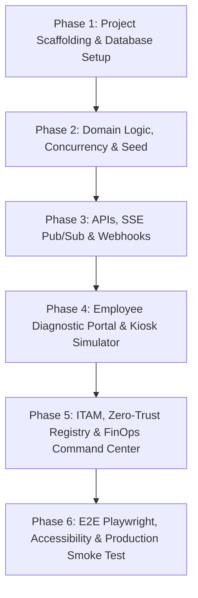

# Project Specification & Execution Plan: KioskDrop Enterprise
**Automated Conference & Presentation Kit Smart-Locker Platform**

> **Authoritative Specification:** This document incorporates all amendments and requirements from `docs/DECISIONS.md` and `execution_plan_review_amendments.md`.

---

## 1. Architectural Vision & Operational Posture
* **Role:** Principal Full-Stack Architect & IoT Systems Engineer
* **Scope:** Production-grade Enterprise Simulator & Reference Architecture solving "last-meter" corporate meeting room AV failures.
* **External Integration Posture:** Built with real enterprise engineering rigor, strict zero-trust validation, and resilient concurrency. External third-party integrations (ServiceNow/Zendesk, Zaggle/Happay corporate cards, SAP/Oracle/Zoho ERP, Saral Sanchar WPC ETA / BIS CRS databases) are accessed through clean adapter interfaces with verified, realistic mock providers.

---

## 2. Locked Technical Specifications (ADR Summary)

* **Framework:** Next.js `14.2.24` (App Router, Server Actions, Route Handlers) with React `18.3.1` (Strict Mode).
* **Language & Typing:** TypeScript `5.6.3` in strict mode.
* **Styling & Design System:** Tailwind CSS `3.4.17`, Lucide React `0.460.0`, custom high-contrast enterprise theme (accessible, dark/light modes).
* **Analytics & Telemetry:** Recharts `2.13.3` (client-only dynamic rendering).
* **Database & ORM:** SQLite via Prisma ORM `6.4.1` with:
  * WAL mode (`PRAGMA journal_mode = WAL;`) and `PRAGMA busy_timeout = 5000;`.
  * Single writer pool and global singleton PrismaClient.
  * Explicit `@@index` on all foreign keys, status fields, and query timestamps.
  * Integer paise representation for all monetary values (`Int`), basis points (`Int`) for rates.
  * String-literal union types with runtime Zod validation for domain states.
* **Validation:** Zod `3.24.2` on all route inputs, query params, and webhook bodies.
* **Real-Time Telemetry:** Server-Sent Events (SSE) Route Handler (`/api/telemetry/stream` with `ReadableStream` on Node.js runtime) using an in-memory event bus on `globalThis` with bounded replay buffer and 15s heartbeats.
* **Testing:** Vitest `2.1.8` for unit/integration tests, `@playwright/test` `1.49.1` for end-to-end browser user flows.

---

## 3. Database Schema Specification (`prisma/schema.prisma`)

```prisma
datasource db {
  provider = "sqlite"
  url      = env("DATABASE_URL")
}

generator client {
  provider = "prisma-client-js"
}

// User Persona Model with Department and Access Credentials
model User {
  id                   String           @id @default(cuid())
  name                 String
  email                String           @unique
  department           String
  role                 String           @default("EMPLOYEE") // EMPLOYEE | IT_ADMIN | FINOPS_AUDITOR
  rfidBadgeId          String           @unique
  biometricTemplateRef String?          // Mock biometric template hash
  tickets              DispatchTicket[]
  custodyLogs          CustodyLog[]
  createdAt            DateTime         @default(now())

  @@index([role])
}

// Corporate Meeting Rooms with Display Topology
model MeetingRoom {
  id            String           @id @default(cuid())
  name          String           // e.g. "Executive Boardroom 4B"
  floor         Int
  building      String
  displayType   String           // "4K_LED_WALL" | "PROJECTOR_HDMI" | "DUAL_MONITOR"
  roomSystem    String           // "BYOD_LEGACY" | "TEAMS_ROOM" | "ZOOM_ROOM"
  qrCodeSlug    String           @unique
  tickets       DispatchTicket[]

  @@index([floor])
}

// Dynamic HSN Customs Duty Rates Table
model TariffRate {
  id            String        @id @default(cuid())
  hsnCode       String        @unique // e.g. "85437099", "85182210", "85285900"
  description   String
  bcdBp         Int           // Basic Customs Duty in basis points (e.g. 2000 = 20.00%)
  swsBp         Int           // Social Welfare Surcharge in bp (e.g. 200 = 2.00% of CIF)
  igstBp        Int           // IGST in basis points (e.g. 1800 = 18.00%)
  effectiveFrom DateTime      @default(now())
  skus          HardwareSKU[]
}

// Hardware SKU Definitions
model HardwareSKU {
  id                  String             @id @default(cuid())
  name                String             // e.g. "Logitech Spotlight BLE Presentation Remote"
  brand               String
  modelNumber         String
  category            String             // DISPLAY_CONVERTER | PRESENTATION_CLICKER | WIRELESS_HDMI_KIT | AUDIO_MIC_KIT | CABLE_HIGH_SPEED
  wholesalePricePaise Int                // Price in integer paise (e.g. 680000 = ₹6,800.00)
  retailPricePaise    Int                // Price in integer paise (e.g. 1099500 = ₹10,995.00)
  reorderThreshold    Int                @default(2)
  reorderQuantity     Int                @default(5)
  tariffRateId        String
  tariffRate          TariffRate         @relation(fields: [tariffRateId], references: [id])
  
  // Technical & Cyber Specs
  dpAltMode           Boolean            @default(false)
  powerDeliveryWatts  Int                @default(0)
  hdcp22Compliant     Boolean            @default(false)
  wirelessBand        String?            // "2.4GHz" | "5GHz" | "BLE"
  encryptionSpec      String?            // "WPA2-Enterprise 802.1X / AES-128"
  
  // Regulatory Metadata (Format-validated mock lookup)
  wpcEtaCertNumber    String?            // e.g. "ETA-SD-20240211409"
  bisCrsNumber        String?            // e.g. "R-41092831"
  assets              AssetItem[]
  poItems             PurchaseOrderItem[]

  @@index([category])
  @@index([tariffRateId])
}

// Physical Serialized Hardware Units
model AssetItem {
  id                  String             @id @default(cuid())
  skuId               String
  sku                 HardwareSKU        @relation(fields: [skuId], references: [id], onDelete: Restrict)
  serialNumber        String             @unique
  usbVendorId         String             // e.g. "0x046D" (Logitech)
  usbProductId        String             // e.g. "0xC53E"
  hidWhitelisted      Boolean            @default(true) // Authorized HID profile
  pkiCertStatus       String             @default("VALID_SCEP_SIGNED")
  condition           String             @default("HEALTHY") // HEALTHY | NEEDS_INSPECTION | DAMAGED
  availability        String             @default("IN_LOCKER") // IN_LOCKER | RESERVED | OUT | QUARANTINED
  compartment         LockerCompartment?
  tickets             DispatchTicket[]
  custodyLogs         CustodyLog[]

  @@index([skuId])
  @@index([availability])
  @@index([condition])
}

// Physical Locker Station
model SmartLocker {
  id                  String              @id @default(cuid())
  name                String              // e.g. "Floor 4 East Wing SmartHub"
  floor               Int
  locationNote        String
  onlineStatus        Boolean             @default(true)
  lastHeartbeatAt     DateTime?           @default(now())
  temperatureC        Float?              @default(22.5)
  compartments        LockerCompartment[]

  @@index([floor])
}

// Individual Locker Bay
model LockerCompartment {
  id                  String            @id @default(cuid())
  lockerId            String
  locker              SmartLocker       @relation(fields: [lockerId], references: [id], onDelete: Restrict)
  compartmentNumber   Int
  status              String            @default("STOCKED_AVAILABLE") 
  // EMPTY | STOCKED_AVAILABLE | RESERVED_FOR_PICKUP | DOOR_OPEN_AWAITING_REMOVAL | CHECKED_OUT | MAINTENANCE_QUARANTINE
  assetId             String?           @unique
  asset               AssetItem?        @relation(fields: [assetId], references: [id], onDelete: SetNull)
  activePinHash       String?           // HMAC-SHA256(PIN, SERVER_PIN_PEPPER)
  
  // Hardware Actuators & Sensors
  solenoidLocked      Boolean           @default(true)
  doorPhysicalOpen    Boolean           @default(false)
  irSensorBreakBeam   Boolean           @default(true)  // true = physical item present
  chargingConnected   Boolean           @default(true)  // true = 5V/3A charging continuity
  tickets             DispatchTicket[]

  @@unique([lockerId, compartmentNumber])
  @@index([lockerId, status])
}

// ITSM Incident & Locker Dispatch Ticket
model DispatchTicket {
  id                  String            @id @default(cuid())
  itsmExternalId      String            @unique // e.g. "INC0049281"
  userId              String
  user                User              @relation(fields: [userId], references: [id], onDelete: Restrict)
  meetingRoomId       String
  meetingRoom         MeetingRoom       @relation(fields: [meetingRoomId], references: [id], onDelete: Restrict)
  assetId             String
  asset               AssetItem         @relation(fields: [assetId], references: [id], onDelete: Restrict)
  compartmentId       String
  compartment         LockerCompartment @relation(fields: [compartmentId], references: [id], onDelete: Restrict)
  reportedSymptom     String
  accessPinHash       String            // HMAC-SHA256
  idempotencyKey      String?           @unique
  status              String            @default("OPEN_RESERVED") 
  // OPEN_RESERVED | DISPENSED_ACTIVE | RETURNED_CLOSED | EXPIRED | CANCELLED | OVERDUE_ESCALATED
  createdAt           DateTime          @default(now())
  expiresAt           DateTime          // Reservation TTL expiry
  dueAt               DateTime?         // Return due timestamp
  dispensedAt         DateTime?
  returnedAt          DateTime?

  @@index([userId])
  @@index([status])
  @@index([meetingRoomId, createdAt])
  @@index([expiresAt])
}

// Tamper-Evident Digital Chain of Custody Audit Log
model CustodyLog {
  id                  String       @id @default(cuid())
  eventType           String       // RESERVED | DOOR_UNLOCKED | ASSET_REMOVED | ASSET_RETURNED | SECURITY_MISMATCH_ALARM | TICKET_EXPIRED
  userId              String?
  user                User?        @relation(fields: [userId], references: [id], onDelete: Restrict)
  assetId             String?
  asset               AssetItem?   @relation(fields: [assetId], references: [id], onDelete: Restrict)
  ticketId            String?
  lockerName          String
  compartmentNumber   Int
  authMethod          String       // PIN | RFID_BADGE | BIOMETRIC | SYSTEM
  details             String?      // JSON stringified details
  prevHash            String?      // SHA-256 tamper-evident chain link
  hash                String       // SHA-256(prevHash + eventType + timestamp + details)
  timestamp           DateTime     @default(now())

  @@index([timestamp])
  @@index([eventType])
}

// B2B Procurement Orders for Locker Restocking
model PurchaseOrder {
  id                  String              @id @default(cuid())
  poNumber            String              @unique // e.g. "PO-2026-001"
  procurementMode     String              // "DIRECT_IMPORT" | "DOMESTIC_WHOLESALE"
  vendorName          String
  totalAmountPaise    Int
  landedDutyPaise     Int                 @default(0)
  status              String              @default("PENDING_RECEPTION") // PENDING_RECEPTION | RECEIVED | INSPECTED_STOCKED
  createdAt           DateTime            @default(now())
  items               PurchaseOrderItem[]
  finopsTransactions FinOpsTransaction[]

  @@index([status])
}

model PurchaseOrderItem {
  id                  String        @id @default(cuid())
  purchaseOrderId     String
  purchaseOrder       PurchaseOrder @relation(fields: [purchaseOrderId], references: [id], onDelete: Cascade)
  skuId               String
  sku                 HardwareSKU   @relation(fields: [skuId], references: [id], onDelete: Restrict)
  quantity            Int
  unitPricePaise      Int

  @@index([purchaseOrderId])
}

// FinOps Restocking Transactions & ERP Reconciliation
model FinOpsTransaction {
  id                  String         @id @default(cuid())
  purchaseOrderId     String?
  purchaseOrder       PurchaseOrder? @relation(fields: [purchaseOrderId], references: [id], onDelete: SetNull)
  provider            String         // "ZAGGLE_CARD" | "HAPPAY_PETTY_CASH"
  mccCode             String         @default("5045") // Computer Peripherals MCC
  policyResult        String         @default("APPROVED") // APPROVED | FLAGGED_POLICY
  erpSyncTarget       String         // "SAP_S4HANA" | "ORACLE_NETSUITE" | "ZOHO_BOOKS"
  erpSyncStatus       String         @default("SYNCED") // SYNCED | PENDING_AUDIT | FLAGGED_POLICY
  vendorName          String
  amountPaise         Int
  gstInvoiceNumber    String         // Max 16 chars per CGST Rule 46 (e.g. "INV-2026-09812")
  itemsSummary        String
  createdAt           DateTime       @default(now())

  @@index([erpSyncStatus])
}

// Webhook Audit & Replay Log
model WebhookEvent {
  id                  String        @id @default(cuid())
  direction           String        // "INBOUND" | "OUTBOUND"
  source              String        // "SERVICENOW" | "ZENDESK"
  externalEventId     String?       @unique
  payload             String        // Raw JSON string
  signatureValid      Boolean       @default(true)
  latencyMs           Int           @default(0)
  status              String        // "SUCCESS" | "FAILED" | "REPLAYED"
  replayOfId          String?
  createdAt           DateTime      @default(now())

  @@index([source, createdAt])
}
```

---

## 4. Pure State Machine Specifications (`src/domain/states.ts`)

### Compartment State Transitions
* `EMPTY` $\rightarrow$ `STOCKED_AVAILABLE` (Admin restock / reception scan)
* `STOCKED_AVAILABLE` $\rightarrow$ `RESERVED_FOR_PICKUP` (Ticket reservation with atomic check)
* `RESERVED_FOR_PICKUP` $\rightarrow$ `DOOR_OPEN_AWAITING_REMOVAL` (Successful PIN/RFID auth at kiosk)
* `RESERVED_FOR_PICKUP` $\rightarrow$ `STOCKED_AVAILABLE` (TTL expiry or user cancellation)
* `DOOR_OPEN_AWAITING_REMOVAL` $\rightarrow$ `CHECKED_OUT` (IR break-beam senses physical asset removal)
* `CHECKED_OUT` $\rightarrow$ `STOCKED_AVAILABLE` (Asset returned, serial verified, charging verified)
* `ANY` $\rightarrow$ `MAINTENANCE_QUARANTINE` (Triggered on foreign USB alarm, mismatch serial, or failed charging continuity)
* `MAINTENANCE_QUARANTINE` $\rightarrow$ `STOCKED_AVAILABLE` / `EMPTY` (Requires IT Admin inspection action)

### Ticket State Transitions
* `OPEN_RESERVED` $\rightarrow$ `DISPENSED_ACTIVE` (Asset physically removed)
* `OPEN_RESERVED` $\rightarrow$ `EXPIRED` (Reservation TTL lapsed without pickup)
* `OPEN_RESERVED` $\rightarrow$ `CANCELLED` (User cancels before pickup)
* `DISPENSED_ACTIVE` $\rightarrow$ `RETURNED_CLOSED` (Hardware verified & returned)
* `DISPENSED_ACTIVE` $\rightarrow$ `OVERDUE_ESCALATED` (Exceeded `RETURN_DUE_HOURS`)
* `OVERDUE_ESCALATED` $\rightarrow$ `RETURNED_CLOSED` (Returned after escalation)

---

## 5. Landed-Cost Duty Arithmetic Specification

All arithmetic is executed in integer paise using round-half-up on each component:
* Assessable Base: $V_a = \text{roundHalfUp}(V_{CIF} \times 1.01)$
* Basic Customs Duty: $BCD = \text{roundHalfUp}(V_a \times 0.20)$
* Social Welfare Surcharge: $SWS = \text{roundHalfUp}(BCD \times 0.10)$
* IGST: $IGST = \text{roundHalfUp}((V_a + BCD + SWS) \times 0.18)$
* Total Customs Duty: $TotalDuty = BCD + SWS + IGST$

### Golden Test Vectors for Vitest:
* **Test Vector A:** CIF ₹1,000.00 (`100000` paise)
  * $V_a = 101,000$ paise (₹1,010.00)
  * $BCD = 20,200$ paise (₹202.00)
  * $SWS = 2,020$ paise (₹20.20)
  * $IGST = 22,180$ paise (₹221.80)
  * Total Landed Duty = `44400` paise (₹444.00, exactly 44.40% of CIF)
  * Net Cost after ITC = $V_{CIF} + BCD + SWS = 122,220$ paise (₹1,222.20)
* **Test Vector B:** CIF ₹34,000.00 (`3400000` paise)
  * $V_a = 3,434,000$ paise
  * $BCD = 686,800$ paise
  * $SWS = 68,680$ paise
  * $IGST = 754,106$ paise
  * Total Landed Duty = `1509586` paise (₹15,095.86)

---

## 6. Implementation Milestones & Strict Quality Gates



### Phase 1: Project Scaffolding & Database Setup
* Clean Next.js `14.2.24` TypeScript project with pinned dependencies.
* Prisma schema with SQLite WAL mode and indices.
* Initial migration and client generation.
* **Quality Gate:** `npm ci`, `npx prisma migrate dev`, `npm run build`, `tsc --noEmit`, `eslint .` pass cleanly on a fresh clone.

### Phase 2: Domain Logic, Concurrency & Seed Engine
* Pure state machines in `src/domain/states.ts`.
* Landed-cost calculation engine in `src/services/landed-cost.ts` with 100% test coverage against Test Vectors A & B.
* Symptom-to-Hardware diagnostic triage service.
* Comprehensive seed dataset:
  * 7 distinct SKUs covering all triage symptoms.
  * 2 lockers (12 bays each) on Floors 4 and 2.
  * 4 meeting rooms with floor fallback test case (Floor 3 room $\rightarrow$ Floor 4 locker).
  * Anomaly test dataset: Room A with 3 unreturned adapters (not flagged), Room B with 4 unreturned adapters (flagged).
* **Quality Gate:** Vitest suite passes 100%, including 20-worker concurrent reservation race-condition test.

### Phase 3: Core API Route Handlers & SSE Telemetry
* `/api/diagnose-and-reserve` with atomic conditional claim.
* `/api/kiosk/authenticate-and-unlock` with rate-limiting & timing-safe PIN check.
* `/api/kiosk/return-asset`, `/api/kiosk/remove-asset`, and `/api/kiosk/report-foreign-device`.
* `/api/telemetry/stream` SSE handler with heartbeat and replay buffer.
* Dual-layer TTL sweeper (lazy + `instrumentation.ts` interval).
* **Quality Gate:** API integration tests on isolated test SQLite database.

### Phase 4: Employee Diagnostic Portal & Kiosk Simulator UI
* Mobile-responsive `/request` QR triage portal with symptom picker and interactive Pickup Pass.
* Interactive `/kiosk-simulator` with 12-bay animated locker bank, tactile numeric PIN pad, RFID badge tap trigger, solenoid door animations, and live sensor telemetry.
* **Quality Gate:** Playwright E2E test verifying end-to-end user journey: reserve $\rightarrow$ OTP generation $\rightarrow$ kiosk unlock $\rightarrow$ device removal $\rightarrow$ return.

### Phase 5: ITAM, Zero-Trust Compliance & FinOps Command Center
* `/admin/compliance`: USB VID/PID whitelist manager, WPC/BIS badges, interactive landed-cost calculator.
* `/admin/finops`: Happay/Zaggle prepaid card ledger, ERP reconciliation exporter (SAP/Oracle/Zoho), reception scan PO restocking.
* `/admin/analytics`: Floor map, locker occupancy metrics, consumption anomaly detection alert.
* `/admin/webhooks`: Live ITSM payload viewer and replay utility.
* **Quality Gate:** Multi-persona RBAC validation and webhook HMAC signature tests.

### Phase 6: Polish, Accessibility & Production Smoke Test
* Axe accessibility audit (contrast, keyboard navigation, `aria-live` announcements).
* Reduced motion respect for solenoid latch animations.
* Production build smoke test with `next start`.
* **Quality Gate:** Zero console errors, clean audit, Lighthouse $>90$.