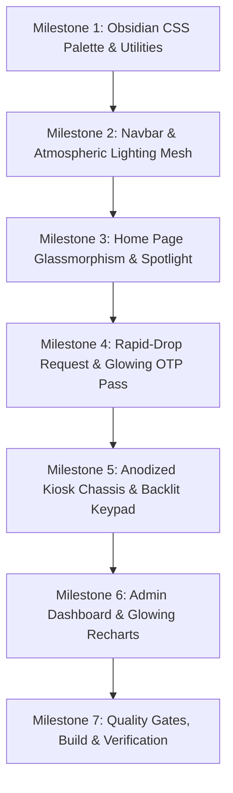

# 🌌 Implementation Plan: Premium "Obsidian & Electric Sapphire" Dark Theme Redesign

> **Project:** KioskDrop Enterprise  
> **Status:** Draft / Ready for User Review  
> **Target Scope:** System-wide dark mode aesthetic overhaul to achieve an eye-pleasing, ergonomic, atmospheric, and luxury enterprise visual experience across all 4 pages.

---

## 1. Aesthetic Diagnosis: Why the Previous Dark Mode Felt Unpleasing

The previous dark mode suffered from common "flat void" dark theme pitfalls:
1. **Ocular Fatigue & Halation (Stark Contrast Shock)**:
   - Pure pitch-black (`#020817` / 96% black) combined with stark white text (`#F8FAFC`) created a harsh ~18:1 contrast ratio. This causes high ocular strain and "halation" (letters appearing to vibrate or blur against the black void).
2. **Lack of Materiality & Depth**:
   - Containers and cards (`#0B1120`) blended into the canvas without tactile hierarchy. Everything felt like flat 1px wireframes rather than an engineered physical enterprise terminal.
3. **Monochrome Coldness**:
   - Overly stark blues without ambient warmth, subtle radial lighting, or glassmorphic translucency.
4. **Harsh Status Indicators**:
   - Status indicators had flat backgrounds without diffuse glow halos, making alarms and badges feel clinical rather than refined.

---

## 2. Design Philosophy: "Obsidian & Electric Sapphire"

Our redesigned dark theme will follow the design ergonomics championed by modern luxury software (Linear, Apple macOS Pro, Vercel, Raycast):

```
┌────────────────────────────────────────────────────────┐
│  Atmospheric Canvas: Deep Obsidian (#0B0F17)          │
│  ┌──────────────────────────────────────────────────┐  │
│  │  Surface Level 1: Frosted Slate (#111726 / 85%)  │  │
│  │  ┌────────────────────────────────────────────┐  │  │
│  │  │  Surface Level 2: Machined Card (#162032)  │  │  │
│  │  │  • Chamfer Highlight: inset 0 1px white/6% │  │  │
│  │  │  • Subtle Sapphire Halo: shadow-blue/5     │  │  │
│  │  │  • Pearl Typography: #F1F5F9 (Anti-glare)  │  │  │
│  │  └────────────────────────────────────────────┘  │  │
│  └──────────────────────────────────────────────────┘  │
└────────────────────────────────────────────────────────┘
```

### Key Visual Pillars
1. **Warm Obsidian Base (`#0B0F17`)**:
   - Instead of pitch-black void, we use a deep, warm Obsidian Slate with 7% luminance. It eliminates ocular halation while preserving deep, battery-efficient dark depth.
2. **Inner Bevel Highlights (`Chamfer Edge`)**:
   - Every card and interactive surface receives a subtle top inner specular highlight (`box-shadow: inset 0 1px 0 0 rgba(255, 255, 255, 0.07)`). This gives surfaces a milled glass or precision-machined anodized aluminum edge.
3. **Atmospheric Ambient Lighting Mesh**:
   - A soft radial lighting aura (`radial-gradient(ellipse at 50% 0%, rgba(56, 189, 248, 0.08), transparent 70%)`) gently illuminates the page from above, giving the interface atmosphere and dimensional depth.
4. **Anti-Glare Pearl Typography Hierarchy**:
   - Headings: Warm Pearl White (`#F1F5F9`) — crisp without harsh eye glare.
   - Body & Descriptions: Balanced Cool Slate (`#94A3B8`) — optimal reading comfort.
   - Metadata & Timestamps: Muted Charcoal Silver (`#64748B`).
5. **Diffused Jewel-Tone Neon Status Lights**:
   - Badges and LED indicators feature diffused ambient glow shadows (e.g. `text-emerald-400 bg-emerald-500/10 border-emerald-500/25 shadow-[0_0_12px_rgba(16,185,129,0.15)]`).

---

## 3. Calibrated Dark Palette Specification

### A. Core Semantic Tokens (`src/app/globals.css`)

| Token | Previous Value | **New "Obsidian Sapphire" Dark Value** | Visual Effect |
| :--- | :--- | :--- | :--- |
| **`--background`** | `224 71% 4%` (`#020817`) | **`222 35% 7%` (`#0B0F17`)** | Deep obsidian slate; eliminates eye glare and void effect |
| **`--foreground`** | `210 40% 98%` (`#F8FAFC`) | **`215 25% 94%` (`#F1F5F9`)** | Warm pearl off-white; high contrast without halation |
| **`--card`** | `224 71% 7%` (`#0B1120`) | **`222 32% 11%` (`#121927`)** | Elevated slate container with distinct visual elevation |
| **`--card-foreground`**| `210 40% 98%` | **`215 25% 94%` (`#F1F5F9`)** | Legible, soft heading text on cards |
| **`--border`** | `217 33% 20%` (`#1E293B`) | **`220 24% 17%` (`#212C3D`)** | Translucent structural dividers with subtle luminosity |
| **`--muted`** | `217 33% 17%` | **`222 28% 14%` (`#192233`)** | Secondary pills, input backgrounds, and chips |
| **`--muted-foreground`**| `215 20% 65%` | **`215 20% 68%` (`#94A3B8`)** | Clear, eye-friendly subtitle text |
| **`--primary`** | `217 91% 60%` (`#3B82F6`) | **`213 94% 68%` (`#60A5FA`)** | Radiant electric sapphire; vivid yet pleasing |
| **`--primary-foreground`**| `222 47% 11%` | **`222 47% 10%` (`#090D16`)** | High contrast dark text on active blue buttons |
| **`--secondary`** | `217 33% 17%` | **`222 28% 14%` (`#192233`)** | Tactile button hover states and subtle tags |
| **`--accent`** | `217 33% 17%` | **`220 30% 16%` (`#1D273B`)** | Subtle interactive hover highlight |

---

## 4. Page-by-Page Aesthetic Engineering Blueprint

### 1. Navigation Bar (`src/components/Navbar.tsx`)
- **Atmospheric Frosted Glass**: `bg-[#0B0F17]/80 backdrop-blur-xl border-b border-white/[0.08] shadow-[0_4px_20px_rgba(0,0,0,0.4)]`.
- **Active Navigation Pill**: Radiant sapphire gradient with subtle glow (`bg-gradient-to-r from-blue-600 to-indigo-600 text-white shadow-[0_0_15px_rgba(59,130,246,0.35)]`).
- **Brand Logo & Persona Button**: Machined chamfer edge (`border border-white/10 bg-slate-900/60 hover:bg-slate-800/80 shadow-[inset_0_1px_0_0_rgba(255,255,255,0.08)]`).
- **Live Telemetry Pill**: Glowing emerald status ring with ambient blur pulse (`bg-emerald-500/10 text-emerald-400 border border-emerald-500/30 shadow-[0_0_10px_rgba(16,185,129,0.2)]`).

### 2. Home Page (`src/app/page.tsx`)
- **Atmospheric Top Spotlight**: Dynamic radial gradient beam (`bg-[radial-gradient(ellipse_80%_50%_at_50%_-20%,rgba(56,189,248,0.12),transparent_70%)]`).
- **Hero Title**: Gradient text from pure pearl to subtle ice blue (`bg-gradient-to-b from-white via-slate-100 to-slate-400 bg-clip-text text-transparent`).
- **Gateway Cards**:
  - Elevated obsidian containers with subtle border luminosity (`border-slate-800 hover:border-blue-500/50`).
  - Specular top highlight: `shadow-[inset_0_1px_0_0_rgba(255,255,255,0.06)]`.
  - Icon container: Soft sapphire glass aura (`bg-blue-500/10 text-blue-400 group-hover:bg-blue-500 group-hover:text-white group-hover:shadow-[0_0_20px_rgba(59,130,246,0.5)]`).

### 3. Rapid-Drop Diagnostic Request Portal (`src/app/request/page.tsx`)
- **Room Selector Pills**: Elevated dark buttons with crisp active state (`bg-blue-600 text-white shadow-[0_0_12px_rgba(59,130,246,0.4)]`).
- **Symptom Diagnostic Cards**:
  - Default: Sleek dark surface (`bg-card/70 border-slate-800 hover:border-slate-700 hover:bg-card`).
  - Selected: Distinct sapphire outline with soft interior glow (`border-blue-500 bg-blue-500/[0.08] shadow-[0_0_20px_rgba(59,130,246,0.15)]`).
- **Illuminated Kiosk OTP Pass**:
  - High-visibility monospace 6-digit PIN with ambient cyan backlight (`bg-[#0D1524] border border-cyan-500/30 text-cyan-300 shadow-[inset_0_0_20px_rgba(6,182,212,0.1),0_0_15px_rgba(6,182,212,0.15)]`).
  - Clean pulsing TTL countdown with amber jewel badge.

### 4. IoT Locker Simulator (`src/app/kiosk-simulator/page.tsx`)
- **Machined Hardware Chassis**:
  - Outer frame styled like an anodized corporate kiosk terminal: `bg-gradient-to-b from-slate-900 via-[#0E1524] to-[#0A0F1A] border border-slate-800 shadow-2xl`.
- **12 Interactive Locker Bays**:
  - **Available Bay**: Matte dark compartment with emerald LED status dot (`shadow-[0_0_8px_rgba(16,185,129,0.5)]`).
  - **Reserved Bay**: Amber ambient pulse with warm door highlight (`border-amber-500/50 bg-amber-500/10 shadow-[0_0_15px_rgba(245,158,11,0.2)]`).
  - **Door Unlocked / Open**: Vibrant sky blue neon border with swinging door perspective animation (`border-sky-400 bg-sky-500/15 shadow-[0_0_20px_rgba(56,189,248,0.3)]`).
  - **Quarantine Bay**: Soft crimson glow (`border-rose-500/50 bg-rose-500/10 text-rose-300 shadow-[0_0_15px_rgba(244,63,94,0.2)]`).
- **Backlit Physical Keypad**:
  - Tactile physical buttons with top specular highlight: `bg-slate-850 hover:bg-slate-800 active:scale-95 border border-white/5 shadow-[inset_0_1px_0_0_rgba(255,255,255,0.08),0_2px_4px_rgba(0,0,0,0.4)]`.
  - Enter Key: Radiant sapphire button with energetic press response.

### 5. ITAM & FinOps Command Center (`src/app/admin/page.tsx`)
- **Metric KPI Cards**: Sleek dark cards with subtle colored top accents and clean typography.
- **Recharts Data Visualization**:
  - Soft charcoal grid lines (`stroke="#1E293B" strokeDasharray="4 4"`).
  - Glowing translucent bar fills:
    - Wholesale B2B: Electric Sapphire (`#38BDF8`).
    - Retail Avoided: Emerald Mint (`#34D399`).
    - Net Savings: Royal Violet (`#A78BFA`).
  - Custom Tooltip: Frosted glass card (`bg-slate-900/90 backdrop-blur-md border border-slate-700/80 shadow-2xl`).
- **Tamper-Evident SHA-256 Custody Logs**:
  - Monospace hash badges in subtle dark zinc with green verification tick icons (`bg-slate-900/80 text-slate-300 border border-slate-800`).

---

## 5. Implementation Milestones



| Step | Action | Files Touched |
| :--- | :--- | :--- |
| **Step 1** | Calibrate dark mode tokens in `src/app/globals.css` (Obsidian canvas, chamfer specular highlights, glowing status badges). | `src/app/globals.css` |
| **Step 2** | Refine `Navbar.tsx` with frosted glass, glowing active pill, and refined persona button. | `src/components/Navbar.tsx` |
| **Step 3** | Redesign `src/app/page.tsx` with top radial spotlight, pearl gradient typography, and elevated glass cards. | `src/app/page.tsx` |
| **Step 4** | Refine `src/app/request/page.tsx` with glowing symptom cards, high-contrast room pills, and cyan backlit OTP display. | `src/app/request/page.tsx` |
| **Step 5** | Overhaul `src/app/kiosk-simulator/page.tsx` with anodized titanium chassis, diffused LED halos, and backlit tactile keypad buttons. | `src/app/kiosk-simulator/page.tsx` |
| **Step 6** | Polish `src/app/admin/page.tsx` KPI cards, landed-cost tables, and Recharts glowing bar aesthetics. | `src/app/admin/page.tsx` |
| **Step 7** | Execute quality gates (`npx tsc --noEmit`, `npx vitest run`, `npm run build`). | Full codebase |

---

## 6. Verification & Acceptance Criteria

- [ ] **No Ocular Halation**: Text against dark backgrounds reads smoothly without harsh contrast shock or fuzzy edges.
- [ ] **Tactile Depth**: Cards, buttons, and bays have a distinct layered physical presence with subtle specular chamfer highlights.
- [ ] **Ambient Illumination**: Subtle top radial spotlight creates visual interest and an executive-grade aesthetic.
- [ ] **Seamless Switching**: Both Light Mode and the new Obsidian Dark Mode switch smoothly using the circular ripple View Transition.
- [ ] **Zero Regressions**: All 39 test cases pass, TypeScript has 0 errors, and production build succeeds.
