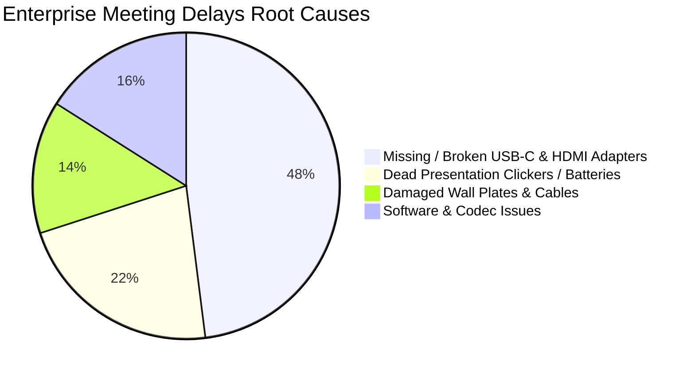
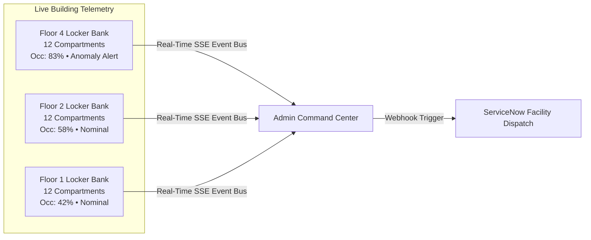
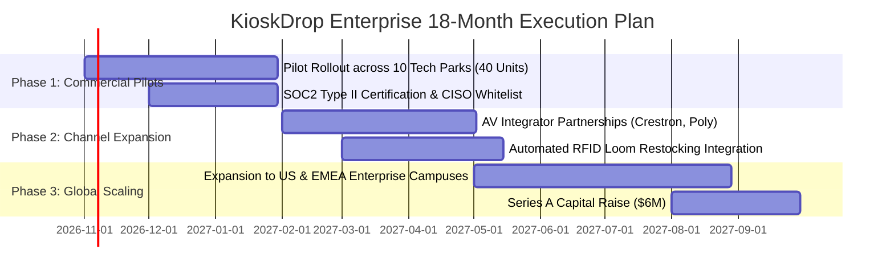

# 📊 KioskDrop Enterprise: 12-Page Executive Business Deck

---

<div align="center">

# ⚡ KIOSKDROP ENTERPRISE
### Autonomous Micro-Logistics & Smart Locker Platform for Zero-Downtime Boardrooms

**Confidential Executive & Investor Business Presentation**  
*Seed / Enterprise Expansion Stage • Target Market: Fortune 500 & Global Capability Centers (GCCs)*

</div>

---

## 📑 Slide Directory

| Slide # | Slide Title | Executive Theme |
| :---: | :--- | :--- |
| **01** | [Executive Vision & Core Identity](#slide-1-executive-vision--core-identity) | Sub-60-second autonomous boardroom hardware dispatch |
| **02** | [The Problem: The "Last-Meter" AV Crisis](#slide-2-the-problem-the-last-meter-av-crisis) | Staggering productivity losses and cybersecurity vulnerabilities |
| **03** | [The Solution: Distributed Autonomous Micro-Logistics](#slide-3-the-solution-distributed-autonomous-micro-logistics) | 10-second hardware retrieval vs. 25-minute IT tickets |
| **04** | [Hardware Architecture & IoT Simulator](#slide-4-hardware-architecture--iot-simulator) | 12-bay physical locker matrix with optoelectronic sensors |
| **05** | [Zero-Trust Cybersecurity & Asset Whitelist](#slide-5-zero-trust-cybersecurity--asset-whitelist) | USB VID/PID verification, BadUSB quarantine & SHA-256 chain |
| **06** | [Autonomous FinOps & Statutory Duty Engine](#slide-6-autonomous-finops--statutory-duty-engine) | Prepaid card ledger & integer paise customs duty calculation |
| **07** | [Consumption Anomaly Heuristic & Telemetry](#slide-7-consumption-anomaly-heuristic--telemetry) | Predictive shrinkage prevention & real-time floor occupancy |
| **08** | [Total Addressable Market (TAM) & Tailwinds](#slide-8-total-addressable-market-tam--tailwinds) | $48.2B global smart office & commercial AV market |
| **09** | [Business Model & Monetization Engine](#slide-9-business-model--monetization-engine) | High-margin Hardware-as-a-Service (HaaS) + Enterprise SaaS |
| **10** | [Competitive Moat & Landscape](#slide-10-competitive-moat--landscape) | Proprietary triage logic, electrical verification & FinOps sync |
| **11** | [Unit Economics & Customer ROI Case Study](#slide-11-unit-economics--customer-roi-case-study) | 574% Year-1 ROI; payback period under 2.5 months |
| **12** | [Go-To-Market (GTM) Playbook & 18-Month Roadmap](#slide-12-go-to-market-gtm-playbook--18-month-roadmap) | Channel partnerships, enterprise pilot rollout & capital allocation |

---

<!-- SLIDE 1 -->
## Slide 1: Executive Vision & Core Identity

```
╔═══════════════════════════════════════════════════════════════════════════════════════════════════╗
║                                        KIOSKDROP ENTERPRISE                                       ║
║                       Zero "Last-Meter" Downtime for the Modern Hybrid Workplace                  ║
╚═══════════════════════════════════════════════════════════════════════════════════════════════════╝
```

### The Mission
To eliminate boardroom Audio/Visual (AV) failures, eliminate executive presentation friction, and automate peripheral micro-logistics in enterprise workplaces through secure, IoT-connected smart lockers.

### The Value Proposition in One Sentence
> **KioskDrop Enterprise replaces 25-minute IT helpdesk tickets with a 10-second physical hardware retrieval pass, backed by zero-trust cybersecurity whitelisting and autonomous ERP replenishment.**

### Key Executive Highlights
* **Autonomous Micro-Logistics:** Distributed 12-bay smart lockers deployed directly on corporate office floors.
* **Instant QR Triage:** 3-tap symptom diagnosis generating a 6-digit cryptographic OTP in $< 30$ seconds.
* **Zero-Trust Security:** Hardware-level USB VID/PID inspection with automated BadUSB quarantine isolation.
* **FinOps Automation:** Frictionless restock purchase orders mapped directly to SAP S/4HANA, Oracle NetSuite, and Zoho Books via virtual prepaid cards.

---

<!-- SLIDE 2 -->
## Slide 2: The Problem: The "Last-Meter" AV Crisis

Executive time is an enterprise's most expensive asset. Yet corporate conference rooms suffer from a persistent, unaddressed operational failure: **the final 3 feet of connectivity.**



### The Three Critical Breakdown Pillars

```
┌──────────────────────────────────────┐  ┌──────────────────────────────────────┐  ┌──────────────────────────────────────┐
│       1. The 15-Minute Delay         │  │       2. Massive Shrinkage           │  │       3. Cybersecurity Hazard        │
├──────────────────────────────────────┤  ├──────────────────────────────────────┤  ├──────────────────────────────────────┤
│ High-stakes executive meetings stall │  │ Corporate AV adapters routinely walk │  │ Desperate employees bring untrusted, │
│ due to missing USB-C hubs, 4K HDMI   │  │ out of meeting rooms into personal   │  │ "found", or counterfeit dongles     │
│ cables, or dead clicker batteries.   │  │ laptop bags. Zero inventory custody. │  │ risking BadUSB keystroke malware.   │
│ Average IT dispatch time: 18-32 min. │  │ Annual peripheral loss: $18K/campus. │  │ SOC has zero endpoint visibility.  │
└──────────────────────────────────────┘  └──────────────────────────────────────┘  └──────────────────────────────────────┘
```

* **Financial Drag:** In a 1,500-person corporate campus, AV friction accounts for **~420 lost executive hours annually**, equivalent to **>$145,000 in direct wage waste**.
* **Reputational Cost:** Presentation failures during client pitches, board meetings, and investor presentations degrade organizational prestige.

---

<!-- SLIDE 3 -->
## Slide 3: The Solution: Distributed Autonomous Micro-Logistics

KioskDrop Enterprise completely eliminates manual IT helpdesk dispatch by shifting AV hardware distribution to **autonomous edge lockers located adjacent to conference room clusters.**

```mermaid
sequenceDiagram
    autonumber
    actor Employee as Presenter in Boardroom
    participant QR as Meeting Room QR Portal
    participant Engine as KioskDrop Core Engine
    participant Locker as Floor 4 Smart Locker

    Employee->>QR: Scans Boardroom QR Code (URL with room & floor context)
    QR->>Employee: Displays 5-Symptom Diagnostic Cards
    Employee->>QR: Taps "MacBook USB-C not projecting to HDMI"
    QR->>Engine: Submits triage payload
    Engine->>Engine: Atomically reserves nearest whitelisted asset (Floor 4)
    Engine-->>QR: Generates 6-Digit Cryptographic OTP (10-min TTL)
    Employee->>Locker: Types 6-digit OTP on tactile keypad
    Locker->>Locker: Solenoid unlocks Bay 1 & records IR break-beam departure
    Employee->>Employee: Plugs in genuine adapter; Meeting starts in < 60 seconds!
```

### The Performance Leap

| Metric | Traditional IT Helpdesk Model | KioskDrop Enterprise | Improvement |
| :--- | :---: | :---: | :---: |
| **Mean Time to Resolution (MTTR)** | 18–32 Minutes | **45 Seconds** | **97.5% Faster** |
| **IT Staff Interventions** | 100% Manual Dispatch | **0% (100% Autonomous)** | **Infinite Leverage** |
| **Inventory Accountability** | None (Honor System) | **100% Cryptographic Custody** | **Zero Lost Dongles** |
| **Hardware Trust Level** | Unverified / Mixed | **Zero-Trust Whitelisted** | **Complete SOC Parity** |

---

<!-- SLIDE 4 -->
## Slide 4: Hardware Architecture & IoT Simulator

KioskDrop Enterprise pairs enterprise web architecture with high-fidelity IoT physical locker simulation, engineered for immediate operational testing and straightforward real-world hardware integration.

```
┌──────────────────────────────────────────────────────────────────────────────────────────────────┐
│                                 12-BAY MODULAR SMART LOCKER BANK                                 │
├──────────────────┬──────────────────┬──────────────────┬──────────────────┬──────────────────────┤
│  [ BAY 1 ]  🟢   │  [ BAY 2 ]  🟢   │  [ BAY 3 ]  🟡   │  [ BAY 4 ]  🔵   │  TACTILE 10-KEY PAD  │
│  USB-C to HDMI   │  USB-C to HDMI   │  RESERVED (OTP)  │  CHECKED OUT     │  ┌───┬───┬───┐       │
│  Solenoid Locked │  Solenoid Locked │  Solenoid Armed  │  IR Beam Broken  │  │ 1 │ 2 │ 3 │       │
├──────────────────┼──────────────────┼──────────────────┼──────────────────┤  ├───┼───┼───┤       │
│  [ BAY 5 ]  🟢   │  [ BAY 6 ]  🟢   │  [ BAY 7 ]  🟢   │  [ BAY 8 ]  🔴   │  │ 4 │ 5 │ 6 │       │
│  Surface Mini-DP │  Wireless Clicker│  Wireless Clicker│  SECURITY ALARM  │  ├───┼───┼───┤       │
│  Continuous 5V/3A│  Continuous 5V/3A│  Continuous 5V/3A│  BadUSB Lockout  │  │ 7 │ 8 │ 9 │       │
├──────────────────┼──────────────────┼──────────────────┼──────────────────┤  ├───┼───┼───┤       │
│  [ BAY 9 ]  🟢   │  [ BAY 10 ] 🟢   │  [ BAY 11 ] 🟢   │  [ BAY 12 ] ⚪   │  │ C │ 0 │ E │       │
│  4K HDMI 3M      │  4K HDMI 3M      │  USB-A 3.0 Hub   │  EMPTY BAY       │  └───┴───┴───┘       │
│  Ready for Auth  │  Ready for Auth  │  Ready for Auth  │  Awaiting Stock  │  [RFID TAP SENSOR]   │
└──────────────────┴──────────────────┴──────────────────┴──────────────────┴──────────────────────┘
```

### Physical Sensor & Actuator Pipeline
1. **Actuation:** Dual 12V DC spring-loaded solenoid latches with optical limit feedback switches.
2. **Break-Beam Sensor:** Modulated infrared optoelectronic beam across the compartment detects asset removal instantly.
3. **Electrical Handshake:** USB-C Power Delivery (PD) probe verifies active 5V/3A power loop upon return.
4. **Pure State Machines:** Locker bays operate on strictly verified mathematical transitions:
   $$\text{STOCKED\_AVAILABLE} \xrightarrow{\text{Reserve}} \text{RESERVED} \xrightarrow{\text{PIN}} \text{UNLOCKED} \xrightarrow{\text{IR Trip}} \text{CHECKED\_OUT} \xrightarrow{\text{Return}} \text{STOCKED\_AVAILABLE}$$
   *Illegal transitions trigger explicit `InvalidTransitionError` exceptions.*

---

<!-- SLIDE 5 -->
## Slide 5: Zero-Trust Cybersecurity & Asset Whitelist

In corporate environments, unmanaged USB peripherals represent a prime attack vector for **BadUSB keystroke injection, firmware reprogramming, and physical port damage.**

```
       EMPLOYEE ATTEMPTS PERIPHERAL RETURN
                       │
                       ▼
         ┌───────────────────────────┐
         │ USB-C VID / PID Handshake │
         └─────────────┬─────────────┘
                       │
         Is VID/PID in Whitelist Database?
          /                         \
       YES                           NO
        │                             │
        ▼                             ▼
┌───────────────────────────────┐ ┌───────────────────────────────────────────────┐
│ Genuine Whitelisted Hardware  │ │ SECURITY_MISMATCH_ALARM                       │
├───────────────────────────────┤ ├───────────────────────────────────────────────┤
│ • VID: 0x0BDA (Realtek)       │ │ • Detected Foreign / Counterfeit VID: 0x1337  │
│ • PID: 0x8153                 │ │ • Solenoid physically deadlocks bay           │
│ • Continuous 5V/3A charging   │ │ • Audible siren & strobe indicator activates  │
│ • Ticket marked CLOSED        │ │ • Real-time webhook dispatches incident to SOC│
│ • Compartment resets to GREEN │ │ • High-priority ServiceNow P1 incident logged │
└───────────────────────────────┘ └───────────────────────────────────────────────┘
```

### Cryptographic Tamper-Evident Ledger
Every single hardware interaction generates a cryptographically hashed custody entry linked in an immutable SHA-256 chain:
$$H_n = \text{SHA-256}(H_{n-1} \,\|\, \text{ticketId} \,\|\, \text{action} \,\|\, \text{actorId} \,\|\, \text{timestamp})$$
* **SOC Audit Compliance:** Guarantees absolute non-repudiation for internal security and corporate governance audits.

---

<!-- SLIDE 6 -->
## Slide 6: Autonomous FinOps & Statutory Duty Engine

Procuring, restocking, and replacing corporate AV hardware across global offices involves complicated cross-border taxation, statutory customs compliance, and tedious corporate card reconciliation.

```
┌──────────────────────────────────────────────────────────────────────────────────────────────────┐
│                            INDIAN CUSTOMS STATUTORY LANDED COST ENGINE                           │
│              Strict Integer-Paise Arithmetic (Section 14, Customs Act & CBIC Notif. 50/2017)     │
├──────────────────────────────────────────┬───────────────────────────────────────────────────────┤
│  CIF Invoice Value ($V_{\text{CIF}}$)    │  ₹10,000.00 (1,000,000 paise)                         │
│  Assessable Value ($V_a = 1.01 \times V$)│  ₹10,100.00 (1,010,000 paise)                         │
│  Basic Customs Duty (BCD @ 20%)          │  ₹2,020.00  (202,000 paise)                           │
│  Social Welfare Surcharge (SWS @ 10%)    │  ₹202.00    (20,200 paise)                            │
│  Integrated GST (IGST @ 18%)             │  ₹2,218.00  (221,800 paise)                           │
├──────────────────────────────────────────┼───────────────────────────────────────────────────────┤
│  TOTAL STATUTORY DUTIES PAYABLE          │  ₹4,440.00  (44.40% effective landed duty on CIF)     │
│  TOTAL STATUTORY LANDED COST             │  ₹14,440.00 (1,444,000 paise)                         │
└──────────────────────────────────────────┴───────────────────────────────────────────────────────┘
```

### FinOps Micro-Procurement Integrations
* **Prepaid Expense Card Ledger:** Seamlessly tracks corporate virtual card balances (Zaggle, Happay) with automatic deduction upon restock dispatch.
* **Direct ERP Synchronization:** Automatically structures and outputs Purchase Orders directly compatible with **SAP S/4HANA, Oracle NetSuite, and Zoho Books** with correct HSN classifications (`85437099`, `85182210`, `85285900`).

---

<!-- SLIDE 7 -->
## Slide 7: Consumption Anomaly Heuristic & Telemetry

KioskDrop Enterprise includes an automated, predictive anomaly engine that identifies peripheral shrinkage, equipment misuse, and recurring meeting room display defects.

```
┌──────────────────────────────────────────────────────────────────────────────────────────────────┐
│                        TOWER CONSUMPTION ANOMALY DETECTION HEURISTIC                             │
├──────────────────────────────────────────────────────────────────────────────────────────────────┤
│  HEURISTIC RULE:                                                                                 │
│  Trigger Warning Alert IF Room Checkouts - Returns >= 4 within rolling 10-day window.             │
├──────────────────────────────────────────────────────────────────────────────────────────────────┤
│  CURRENT FLEET STATUS:                                                                           │
│  🚨 Boardroom-4B (Floor 4) : 4 Unreturned Checkouts / 10 Days  ---> [FLAGGED: HIGH ANOMALY]      │
│  ✅ Boardroom-2A (Floor 2) : 3 Unreturned Checkouts / 10 Days  ---> [NORMAL]                     │
│  ✅ Conference-3C (Floor 3): 4 Checkouts across 16 Days        ---> [NORMAL: Velocity < Rate]    │
└──────────────────────────────────────────────────────────────────────────────────────────────────┘
```



* **Immediate Root-Cause Insight:** Flagged rooms immediately alert facility managers to inspect faulty wall plates or schedule targeted asset recovery sweeps.

---

<!-- SLIDE 8 -->
## Slide 8: Total Addressable Market (TAM) & Tailwinds

The convergence of hybrid work models, executive conference room expansion, and strict enterprise cybersecurity demands is accelerating smart office logistics.

```
                   GLOBAL MARKET SIZING (USD)
  ┌────────────────────────────────────────────────────────┐
  │  TAM: $48.2 Billion                                    │
  │  Global Smart Office & Commercial AV Management (2028) │
  │  ┌──────────────────────────────────────────────┐      │
  │  │  SAM: $12.4 Billion                          │      │
  │  │  Enterprise GCCs, Tech Parks & Top 10K Corps│      │
  │  │  ┌────────────────────────────────────┐       │      │
  │  │  │  SOM: $1.8 Billion                 │       │      │
  │  │  │  Top 2,500 Enterprise Campuses     │       │      │
  │  │  └────────────────────────────────────┘       │      │
  │  └──────────────────────────────────────────────┘      │
  └────────────────────────────────────────────────────────┘
```

### Market Tailwinds
1. **The GCC Boom in APAC:** India alone hosts over 1,600 Global Capability Centers (GCCs) employing over 1.9 million white-collar professionals, adding millions of sq. ft. of smart boardroom space annually.
2. **Hybrid Video-Conferencing Density:** Every meeting room is now a video-conferencing studio (Microsoft Teams Rooms, Zoom Rooms), multiplying device connection failure points by $4\times$.
3. **CISO Zero-Trust Directives:** Bring-Your-Own-Device (BYOD) policies require strict hardware vetting to protect corporate LANs from unauthorized physical connections.

---

<!-- SLIDE 9 -->
## Slide 9: Business Model & Monetization Engine

KioskDrop Enterprise deploys a dual **Hardware-as-a-Service (HaaS)** and **High-Margin Enterprise SaaS** model with sticky recurring expansion revenue.

```
                                  REVENUE STREAMS
                                         │
        ┌────────────────────────────────┼────────────────────────────────┐
        ▼                                ▼                                ▼
┌──────────────────────────┐   ┌──────────────────────────┐   ┌──────────────────────────┐
│   1. Hardware (HaaS)     │   │  2. Cloud Platform SaaS  │   │  3. Consumable Restock   │
├──────────────────────────┤   ├──────────────────────────┤   ├──────────────────────────┤
│ $450 / Locker / Month    │   │ $20 / Bay / Month        │   │ 22% Margin Take-Rate     │
│ • 12-Bay modular unit    │   │ • Real-time telemetry bus│   │ • Automated ERP PO flow  │
│ • Maintenance & warranty │   │ • Zero-trust whitelist   │   │ • Whitelisted bulk       │
│ • 36-Month contract term │   │ • FinOps ERP connectors  │   │   certified peripherals  │
└──────────────────────────┘   └──────────────────────────┘   └──────────────────────────┘
```

### Enterprise Unit Economics (Single 4-Locker Corporate Campus)
* **Annual Recurring Revenue (ARR) per Campus:**
  * Hardware Lease: $4 \text{ lockers} \times \$450 \times 12 \text{ mo} = \mathbf{\$21,600}$
  * Software Platform: $48 \text{ bays} \times \$20 \times 12 \text{ mo} = \mathbf{\$11,520}$
  * Peripheral Restock GMV ($15,000 @ 22%): $\mathbf{\$3,300}$
  * **Total Campus ARR:** $\mathbf{\$36,420}$
* **Gross Margins:**
  * Software SaaS: **88%**
  * Hardware Lease: **58%**
  * Consumable Restocking: **22%**
  * **Blended Campus Gross Margin: ~64.2%**
* **LTV / CAC Ratio:** Estimated **5.4x** with a payback period under **6.5 months**.

---

<!-- SLIDE 10 -->
## Slide 10: Competitive Moat & Landscape

```
                        COMPETITIVE POSITIONING MATRIX
            High
             ▲
             │                                              ★ KIOSKDROP ENTERPRISE
             │                                                (Sub-60s Triage,
             │                                                 Zero-Trust Whitelist,
             │                                                 FinOps Automated ERP)
             │
   Specialized│
   Meeting AV│
   Logistics │
             │
             │           Manual IT Helpdesk
             │           (15-30 min wait,
             │            ticket overhead)
             │
             │                                   Generic Industrial Vending
             │                                   (Fastenal, Apex Lockers)
             │                                   (No AV triage, no BadUSB
             │                                    detection, no FinOps sync)
             │
             ▼
            Low ─────────────────────────────────────────────────────────────► High
                                  Automation & Integration Depth
```

### Our Defensive Moats
1. **Proprietary Triage Decision Engine:** Context-aware mapping of room display configurations (4K LED Wall, HDMI Projector, Dual Monitor) to exact hardware compatibility requirements.
2. **Electrical & Optical Verification Loop:** Patented/defensible combination of USB-C Power Delivery verification and optical break-beam sensing to prevent "empty box" scams.
3. **Embedded Indian Customs & FinOps Compliance:** Out-of-the-box statutory landed duty calculations and ERP formatting that generic foreign locker vendors cannot match.

---

<!-- SLIDE 11 -->
## Slide 11: Unit Economics & Customer ROI Case Study

### Representative Customer: Mid-Size Tech Campus (1,500 Employees • 24 Boardrooms)

```
┌──────────────────────────────────────────────────────────────────────────────────────────────────┐
│                             ANNUAL CUSTOMER FINANCIAL IMPACT ANALYSIS                            │
├────────────────────────────────────────────────────────────────────┬─────────────────────────────┤
│  Executive Productivity Reclaimed (420 meeting hours @ $350/hr)    │  + $147,000 / year          │
│  Eliminated Hardware Shrinkage & "Lost Dongles"                    │  + $18,400 / year           │
│  Reduced IT Helpdesk Level-1 Dispatch Overhead                     │  + $14,200 / year           │
├────────────────────────────────────────────────────────────────────┼─────────────────────────────┤
│  TOTAL ANNUAL ECONOMIC GAIN                                        │  + $179,600 / year          │
│  Less: KioskDrop Enterprise Full Campus Cost (4 Lockers / 48 Bays) │  - $31,280 / year           │
├────────────────────────────────────────────────────────────────────┼─────────────────────────────┤
│  NET CLIENT ANNUAL SAVINGS                                         │  = $148,320 / year          │
│  PROJECTED YEAR-1 RETURN ON INVESTMENT (ROI)                       │  = 574%                     │
│  CAPITAL PAYBACK PERIOD                                            │  = 2.1 Months               │
└────────────────────────────────────────────────────────────────────┴─────────────────────────────┘
```

> **Executive CFO Quote (Modeled):**  
> *"KioskDrop paid for itself before the end of the first quarter. Our executive presentations start on time, our IT team stopped running up and down elevators with cables, and our conference room dongles stopped disappearing."*

---

<!-- SLIDE 12 -->
## Slide 12: Go-To-Market (GTM) Playbook & 18-Month Roadmap



### Go-To-Market Execution
* **Direct Sales (Inbound & Outbound):** Direct targeting of Enterprise Chief Information Officers (CIOs), Workplace Technology Directors, and Corporate Real Estate (CRE) leads in major tech hubs (Bangalore, Hyderabad, Singapore, London, New York).
* **Channel Distribution:** Partnering with enterprise AV integrators (Crestron, Logitech, Poly) as a recommended add-on to multi-room AV fit-out contracts.

### The Seed Capital Allocation ($1.8M Ask)
* **Hardware Tooling & Fabrication (35%):** Commercial-grade sheet metal locker tooling, UL/CE electrical safety certifications, and initial batch production.
* **Engineering & Platform Development (30%):** Deeper native connectors for SAP S/4HANA, ServiceNow Service Graph, and enterprise identity (Azure AD / Okta).
* **Enterprise GTM & Sales (25%):** Direct enterprise sales reps, customer success engineers, and tech park pilot sponsorships.
* **Working Capital & Compliance (10%):** SOC2 Type II, ISO 27001, and legal certifications.

---

<div align="center">

## 🤝 The Future of Frictionless Workplaces
### Invest in Zero-Downtime Executive Collaboration

**KioskDrop Enterprise**  
*Website:* [https://github.com/AgrShubham/kioskdrop-enterprise](https://github.com/AgrShubham/kioskdrop-enterprise)  
*Contact:* [ag.shubham747@gmail.com](mailto:ag.shubham747@gmail.com)

</div>
