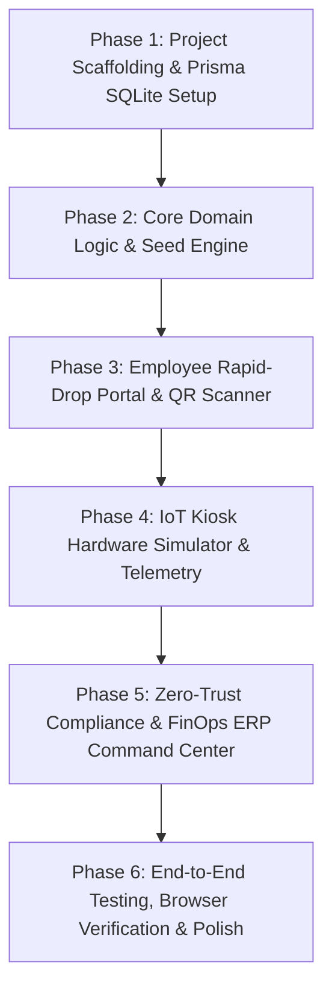

# Production Engineering Plan: KioskDrop Enterprise
**Enterprise Conference Kit Smart-Locker & Micro-Logistics Platform**

---

## 1. Executive Summary & Problem Space

### Problem Statement
In modern hybrid enterprises, 15–20% of high-stakes executive boardrooms and client pitch rooms experience "last-meter" Audio/Visual (AV) failures (missing/damaged USB-C converters, broken HDMI cables, dead presentation clickers, non-compliant wireless display transmitters).
* External rapid-delivery couriers cannot pass corporate physical security turnstiles.
* Enterprise Zero-Trust policies strictly prohibit unauthorized USB devices due to BadUSB / HID keystroke injection attack vectors.
* IT and AV technicians are often occupied with higher-tier tickets and cannot physically deliver cables within the critical 5-minute meeting start window.

### Solution Architecture: KioskDrop Enterprise
A full-stack, enterprise-grade automated smart-locker and micro-logistics platform stationed across office floors featuring:
1. **QR Symptom Diagnostic Portal (`/request`)**: Instant symptom-to-hardware triage for meeting room hosts, automatically booking the nearest floor locker compartment with a 6-digit OTP and NFC/RFID digital badge token.
2. **Interactive IoT Smart-Locker Kiosk Simulator (`/kiosk-simulator`)**: High-fidelity physical hardware simulation (12-compartment locker bank, solenoid lock actuators, IR break-beam presence sensors, USB-C charging continuity sensors, and multi-factor PIN/RFID/Biometric authentication).
3. **Zero-Trust Cybersecurity & Regulatory Registry (`/admin/compliance`)**: USB Vendor ID (VID), Product ID (PID), and Serial Number hardware whitelisting; WPC Equipment Type Approval (ETA) and BIS CRS compliance tracking; automated compound landed-cost calculator for HSN duty stacks.
4. **ITSM Webhook & FinOps Replenishment Engine (`/admin/finops`)**: Bi-directional ServiceNow / Zendesk incident lifecycle sync, Happay/Zaggle digital petty-cash prepaid card replenishment, and SAP/Oracle/Zoho ERP reconciliation.
5. **ITAM 360° Telemetry & Anomaly Analytics (`/admin/analytics`)**: Live floor map, compartment occupancy telemetry, and consumption anomaly detection (detecting high-loss conference rooms).

---

## 2. Technology Stack & Architectural Decisions

| Layer | Selection | Engineering Rationale |
| :--- | :--- | :--- |
| **Framework** | **Next.js 14+ (App Router)** | Full-stack React Server Components (RSC), Server Actions, API Route Handlers, and optimized static/dynamic rendering. |
| **Language** | **TypeScript (Strict Mode)** | End-to-end type safety across API contracts, database models, and UI state. |
| **Styling & UI** | **Tailwind CSS + Lucide Icons + Custom Modern Design System** | Modern enterprise dark/light palette, glassmorphism, responsive grid, accessible interactive components, zero unnecessary bundle bloat. |
| **Charts & Analytics** | **Recharts** | Interactive ITAM asset consumption, inventory depletion trends, and cost-comparison visualizations. |
| **Database & ORM** | **Prisma ORM with SQLite** | **Key Architectural Resolution:** The initial draft proposed native Prisma `enum` declarations with SQLite. SQLite does *not* support native enums and fails compilation. We use SQLite-compatible String types with TypeScript `const` enum unions and validation layers for instant zero-dependency local setup, while maintaining 100% schema compatibility with PostgreSQL. |
| **Validation** | **Zod** | Runtime schema validation for all API route inputs, webhook payloads, and diagnostic forms. |
| **Real-Time Telemetry** | **Server-Sent Events (SSE) + BroadcastChannel API** | Native HTTP streaming via Next.js Route Handlers (`ReadableStream`) paired with browser `BroadcastChannel` for multi-tab state sync (Request Page $\leftrightarrow$ Kiosk Simulator $\leftrightarrow$ Admin Dashboard) without external WebSocket server infrastructure. |
| **Role-Based Impersonation** | **Session Context & Demo Role Switcher** | Instant toggle between `EMPLOYEE`, `IT_ADMIN`, and `FINOPS_AUDITOR` with pre-configured personas (`Aarav Sharma`, `Priya Patel`, `Vikram Malhotra`) to facilitate complete end-to-end testing without external OAuth dependencies. |

---

## 3. Database Schema Specification (`prisma/schema.prisma`)

```prisma
datasource db {
  provider = "sqlite"
  url      = env("DATABASE_URL")
}

generator client {
  provider = "prisma-client-js"
}

// User Model with Corporate Department and RFID Credentials
model User {
  id            String           @id @default(cuid())
  name          String
  email         String           @unique
  department    String
  role          String           @default("EMPLOYEE") // EMPLOYEE, IT_ADMIN, FINOPS_AUDITOR
  rfidBadgeId   String           @unique
  tickets       DispatchTicket[]
  custodyLogs   CustodyLog[]
  createdAt     DateTime         @default(now())
}

// Corporate Meeting Rooms with Display Profile
model MeetingRoom {
  id            String           @id @default(cuid())
  name          String           // e.g. "Executive Boardroom 4B"
  floor         Int
  building      String
  displayType   String           // "4K_LED_WALL", "PROJECTOR_HDMI", "DUAL_MONITOR"
  roomSystem    String           // "BYOD_LEGACY", "TEAMS_ROOM", "ZOOM_ROOM"
  qrCodeSlug    String           @unique
  tickets       DispatchTicket[]
}

// Catalog of Standardized Hardware SKUs & Regulatory Attributes
model HardwareSKU {
  id                  String      @id @default(cuid())
  name                String      // e.g. "Logitech Spotlight BLE Presentation Remote"
  brand               String
  modelNumber         String
  category            String      // DISPLAY_CONVERTER, PRESENTATION_CLICKER, WIRELESS_HDMI_KIT, AUDIO_MIC_KIT, CABLE_HIGH_SPEED
  wholesalePriceINR   Float
  retailPriceINR      Float
  hsnCode             String      // "85437099", "85182210", "85285900"
  importDutyPercent   Float       @default(44.14) // Compound BCD + SWS + IGST
  
  // Technical & Cyber Specs
  dpAltMode           Boolean     @default(false)
  powerDeliveryWatts  Int         @default(0)
  hdcp22Compliant     Boolean     @default(false)
  wirelessBand        String?     // "2.4GHz", "5GHz", "BLE"
  encryptionSpec      String?     // "WPA2-Enterprise 802.1X / AES-128"
  
  // Indian Regulatory Compliance
  wpcEtaCertNumber    String?     // Saral Sanchar WPC ETA Number
  bisCrsNumber        String?     // BIS CRS Registration Number
  assets              AssetItem[]
}

// Physical Tracked Hardware Assets (Whitelisted Units)
model AssetItem {
  id                  String             @id @default(cuid())
  skuId               String
  sku                 HardwareSKU        @relation(fields: [skuId], references: [id])
  serialNumber        String             @unique
  usbVendorId         String             // e.g. "0x046D" (Logitech)
  usbProductId        String             // e.g. "0xC53E"
  hidWhitelisted      Boolean            @default(true)
  pkiCertStatus       String             @default("VALID_SCEP_SIGNED")
  condition           String             @default("HEALTHY") // HEALTHY, NEEDS_INSPECTION, DAMAGED
  compartment         LockerCompartment?
  tickets             DispatchTicket[]
  custodyLogs         CustodyLog[]
}

// Physical Locker Bank Stationed on Floor
model SmartLocker {
  id                  String              @id @default(cuid())
  name                String              // e.g. "Floor 4 East Wing SmartHub"
  floor               Int
  locationNote        String
  onlineStatus        Boolean             @default(true)
  compartments        LockerCompartment[]
}

// Individual Locker Compartment with Actuators & Sensors
model LockerCompartment {
  id                  String            @id @default(cuid())
  lockerId            String
  locker              SmartLocker       @relation(fields: [lockerId], references: [id])
  compartmentNumber   Int
  status              String            @default("AVAILABLE_OCCUPIED") // AVAILABLE_OCCUPIED, RESERVED_FOR_PICKUP, IN_USE_CHECKED_OUT, MAINTENANCE_QUARANTINE
  assetId             String?           @unique
  asset               AssetItem?        @relation(fields: [assetId], references: [id])
  activePin           String?           // 6-digit OTP when reserved
  
  // Hardware Simulation Telemetry
  solenoidLocked      Boolean           @default(true)
  doorPhysicalOpen    Boolean           @default(false)
  irSensorBreakBeam   Boolean           @default(true)  // true = device present in bay
  chargingConnected   Boolean           @default(true)  // true = plugged into USB-C charging bay
}

// ITSM Incident & Locker Dispatch Ticket
model DispatchTicket {
  id                  String       @id @default(cuid())
  itsmExternalId      String       @unique // e.g. "INC0049281" (ServiceNow)
  userId              String
  user                User         @relation(fields: [userId], references: [id])
  meetingRoomId       String
  meetingRoom         MeetingRoom  @relation(fields: [meetingRoomId], references: [id])
  assetId             String
  asset               AssetItem    @relation(fields: [assetId], references: [id])
  reportedSymptom     String
  accessPin           String
  status              String       @default("OPEN_RESERVED") // OPEN_RESERVED, DISPENSED_ACTIVE, RETURNED_CLOSED, OVERDUE_ESCALATED
  createdAt           DateTime     @default(now())
  dispensedAt         DateTime?
  returnedAt          DateTime?
}

// Immutable Digital Chain of Custody Audit Log
model CustodyLog {
  id                  String    @id @default(cuid())
  eventType           String    // RESERVED, DOOR_UNLOCKED, ASSET_REMOVED, ASSET_RETURNED, SECURITY_MISMATCH_ALARM
  userId              String
  user                User      @relation(fields: [userId], references: [id])
  assetId             String
  asset               AssetItem @relation(fields: [assetId], references: [id])
  lockerName          String
  compartmentNumber   Int
  authMethod          String    // PIN, RFID_BADGE, BIOMETRIC
  timestamp           DateTime  @default(now())
}

// FinOps Restocking & ERP Reconciliation Transactions
model FinOpsTransaction {
  id                  String    @id @default(cuid())
  provider            String    // ZAGGLE_CARD, HAPPAY_PETTY_CASH
  erpSyncTarget       String    // SAP_S4HANA, ORACLE_NETSUITE, ZOHO_BOOKS
  erpSyncStatus       String    // SYNCED, PENDING_AUDIT, FLAGGED_POLICY
  vendorName          String
  amountINR           Float
  gstInvoiceNumber    String
  itemsSummary        String
  createdAt           DateTime  @default(now())
}
```

---

## 4. Detailed Module Specifications

### Module 1: Employee "Rapid-Drop" QR Diagnostic Portal (`/request`)
* **Context Sensing**: Automatically parses `?room=Boardroom-4B&floor=4` from simulated QR code scan.
* **Deterministic Symptom-to-Hardware Triage Matrix**:
  1. `SYMPTOM_NO_DISPLAY_BYOD`: Recommends **Multi-port USB-C to HDMI Converter (DP Alt Mode + 60W PD, HDCP 2.2)** or **Wireless HDMI Kit** if port is mechanically damaged.
  2. `SYMPTOM_VIDEO_WALL_BLACKOUT`: Recommends **HDCP 2.2 Compliant Converter** or **High-Speed HDMI 2.1 Cable**.
  3. `SYMPTOM_AV_DESYNC`: Recommends **Direct High-Bandwidth DisplayPort Cable** (bypasses video scaler buffers) + notifies AV DSP technician.
  4. `SYMPTOM_HYBRID_PRESENTATION_CONTROL`: Recommends **Logitech Spotlight Plus BLE Presenter** (supports digital on-screen highlighting for remote Zoom/Teams participants).
  5. `SYMPTOM_AUDIO_ECHO_HOLLOW`: Recommends **Directional Boundary Mic Kit**.
* **Instant Reservation Flow**:
  - Finds nearest locker on the user's floor with a healthy, whitelisted asset matching the diagnosed SKU.
  - Updates compartment status to `RESERVED_FOR_PICKUP` and sets a cryptographically random 6-digit OTP.
  - Generates ServiceNow Incident ID (`INC0089201`).
  - Emits real-time SSE event to notify Kiosk Simulator.
  - Renders user pickup pass with countdown timer, PIN display, and one-click "Simulate RFID Badge Tap" trigger.

### Module 2: Interactive IoT Smart-Locker Kiosk Simulator (`/kiosk-simulator`)
* **Locker Bank Display**: 12-bay interactive grid (2 rows of 6 or 3 rows of 4) showing:
  - LED status indicators: Green (Available), Amber (Reserved for Pickup), Blue (Active Door Open / In Use), Red (Quarantine).
  - Sensor readouts: Solenoid Lock (Locked/Unlocked), Bay Break-Beam IR (Device Present / Empty), USB-C Charging (Power Draw Active).
* **Interactive Authentication Console**:
  - Numeric PIN keypad with tactile sounds and visual feedback.
  - "Tap Corporate RFID Badge" button (passes active employee badge ID).
  - "Scan Biometric Fingerprint" button (passes authenticated credential).
* **Physical Hardware Interactivity**:
  - `[Pop Solenoid Latch & Open Door]` -> Simulates mechanical unlock.
  - `[Remove Device from Bay]` -> Simulates IR beam break, changes asset state to `DISPENSED_ACTIVE`, updates ticket.
  - `[Return Device & Plug USB-C]` -> Verifies serial number & VID/PID match, detects 5V/3A charging continuity, latches solenoid lock, closes ticket, and resets bay to `AVAILABLE_OCCUPIED`.
  - Simulates Security Alarms: e.g. Attempting to insert an unauthorized foreign USB stick triggers `SECURITY_MISMATCH_ALARM` in audit log.

### Module 3: Zero-Trust Cybersecurity & Regulatory Registry (`/admin/compliance`)
* **Endpoint Protection Whitelist Engine**:
  - Inspects USB Vendor IDs (`0x046D` Logitech, `0x0600` Barco, `0x291A` Anker, `0x0BDA` Realtek).
  - Validates `hidWhitelisted` status (blocks unvetted devices with unauthorized HID keyboard descriptor profiles).
  - SCEP / PKI Certificate verification status for 802.1X enterprise wireless kits.
* **Indian Regulatory & HSN Landed-Cost Calculator**:
  - Live verification of WPC ETA IDs (Saral Sanchar standard) and BIS CRS registration numbers.
  - **Tariff Stack Formula**:
    $$\text{Assessable Value } (V_{assess}) = \text{CIF Value } (V) \times 1.01$$
    $$\text{Basic Customs Duty } (\text{BCD}) = 20\% \times V_{assess}$$
    $$\text{Social Welfare Surcharge } (\text{SWS}) = 10\% \times \text{BCD} = 2\% \times V_{assess}$$
    $$\text{IGST} = 18\% \times (V_{assess} + \text{BCD} + \text{SWS}) = 22.1796\% \times V_{assess}$$
    $$\text{Compound Duty Stack} \approx 44.18\% \text{ to } 49.15\%$$
  - Real-time calculator letting finance officers input CIF unit value, select HSN code, and instantly view landed unit cost, wholesale procurement savings, and GST input tax credit (ITC).

### Module 4: ITSM Webhook & FinOps Restocking Engine (`/admin/finops`)
* **Bidirectional ITSM Webhook Stream**:
  - Live webhook feed viewer for `/api/webhooks/servicenow` and `/api/webhooks/zendesk`.
  - JSON payload inspector with syntax highlighting, latency metrics, and "Replay Webhook" utility.
* **Reception-to-Floor Restocking Logistics**:
  - Low-stock threshold triggers B2B order to Dark Store / Wholesale distributor.
  - Hardware Reception Inspection Kiosk: IT technicians scan incoming gear (barcode + serial number + VID/PID scan) before moving into floor lockers.
* **FinOps Petty Cash & ERP Sync**:
  - Corporate prepaid card transaction logs (Zaggle / Happay) with MCC code enforcement (`MCC 5045`).
  - One-click ERP export simulating SAP S/4HANA BAPI, Oracle NetSuite, and Zoho Books invoice reconciliation.

### Module 5: ITAM 360° Telemetry & Anomaly Analytics (`/admin/analytics`)
* **Interactive Floor Map**: Visual floorplan of Corporate Tower showing Smart Locker locations, live occupancy percentages, and temperature/connectivity telemetry.
* **Consumption Anomaly Detection Engine**:
  - Algorithmic scanner detecting recurring hardware loss:
    * *Flagged Rule:* Room consuming $>3$ adapters in 14 days without return.
    * *Actionable Insight:* Triggers "Recommend Permanent Teams Room Console Upgrade or Inspect Mechanical Port Degradation".
* **Financial Savings Telemetry**:
  - Recharts metric comparing B2B Wholesale procurement costs vs. urgent retail delivery premiums (average enterprise savings: ₹1,400 per incident).

---

## 5. API Contracts & Webhook Specification

### 1. `POST /api/diagnose-and-reserve`
* **Request Body (Zod validated)**:
  ```json
  {
    "userId": "usr_emp_01",
    "meetingRoomId": "room_boardroom_4b",
    "symptomCode": "SYMPTOM_NO_DISPLAY_BYOD",
    "preferredSkuId": null
  }
  ```
* **Response Body (`201 Created`)**:
  ```json
  {
    "success": true,
    "ticketId": "tkt_clx891",
    "itsmTicketNumber": "INC0049281",
    "locker": {
      "id": "lkr_floor4",
      "name": "Floor 4 East Wing SmartHub",
      "floor": 4,
      "compartmentNumber": 3
    },
    "allocatedAsset": {
      "serialNumber": "SN-USBC-89211",
      "skuName": "Multi-Port USB-C to HDMI 4K Converter (DP Alt Mode + 60W PD)",
      "usbVendorId": "0x291A",
      "usbProductId": "0xA102"
    },
    "accessPin": "849201",
    "expiresAt": "2026-10-28T19:30:00Z"
  }
  ```

### 2. `POST /api/kiosk/authenticate-and-unlock`
* **Request Body**:
  ```json
  {
    "lockerId": "lkr_floor4",
    "authMethod": "PIN",
    "credentialValue": "849201"
  }
  ```
* **Response Body (`200 OK`)**:
  ```json
  {
    "success": true,
    "unlockedCompartment": 3,
    "solenoidReleased": true,
    "assetSerialNumber": "SN-USBC-89211",
    "message": "Compartment 3 unlocked. Please retrieve your device and close the door."
  }
  ```

### 3. `POST /api/kiosk/return-asset`
* **Request Body**:
  ```json
  {
    "lockerId": "lkr_floor4",
    "compartmentNumber": 3,
    "assetSerialNumber": "SN-USBC-89211",
    "chargingConnected": true
  }
  ```
* **Response Body (`200 OK`)**:
  ```json
  {
    "success": true,
    "ticketClosed": "INC0049281",
    "compartmentStatus": "AVAILABLE_OCCUPIED",
    "auditEventId": "log_custody_9921"
  }
  ```

### 4. `POST /api/finops/replenish`
* **Request Body**:
  ```json
  {
    "skuId": "sku_spotlight_ble",
    "quantity": 5,
    "fulfillmentChannel": "B2B_WHOLESALE",
    "cardProvider": "ZAGGLE_CARD",
    "erpTarget": "SAP_S4HANA"
  }
  ```
* **Response Body (`201 Created`)**:
  ```json
  {
    "success": true,
    "transactionId": "txn_zaggle_4491",
    "amountINR": 34000.00,
    "landedDutyINR": 15007.60,
    "erpSyncStatus": "SYNCED",
    "gstInvoiceNumber": "GST-IN-2026-88192"
  }
  ```

### 5. `GET /api/telemetry/stream` (Server-Sent Events)
* Emits real-time SSE frames for:
  - `LOCKER_RESERVED`
  - `DOOR_UNLOCKED`
  - `ASSET_DISPENSED`
  - `ASSET_RETURNED`
  - `INVENTORY_RESTOCKED`

---

## 6. Implementation Milestones & Roadmap



### Phase 1: Project Scaffolding & Prisma SQLite Setup
* Initialize Next.js 14+ with TypeScript, Tailwind CSS, and essential UI utilities.
* Configure `prisma/schema.prisma` with SQLite provider.
* Run Prisma migrations and generate `@prisma/client`.

### Phase 2: Core Domain Logic & Seed Engine (`prisma/seed.ts`)
* Implement seed script with realistic corporate data:
  - 4 Executive Meeting Rooms (Executive Boardroom 4B, Innovation Lab 4A, Townhall Auditorium 2A, Client Pitch Room 3C).
  - 4 Standard Hardware SKUs with accurate Indian market prices (Logitech Spotlight, USB-C 4K 60W, 4K Wireless HDMI, High-Speed HDMI).
  - 2 Smart Lockers (16 total compartments populated with serial numbers, VID/PID, and WPC/BIS IDs).
  - 3 Default User Personas (Employee, IT Admin, FinOps Auditor).
  - 10 Historical Custody & FinOps logs.
* Implement diagnostic triage service and landed-cost calculation utilities with unit tests.

### Phase 3: Employee Rapid-Drop Portal (`/request`)
* Mobile-optimized QR room diagnostic interface.
* Interactive symptom selector with live hardware preview.
* Instant locker compartment reservation and pickup pass with countdown timer, PIN display, and RFID badge trigger.

### Phase 4: IoT Kiosk Hardware Simulator (`/kiosk-simulator`)
* Split-screen interactive locker bank UI with 12 visual compartments.
* Real-time door solenoid latch animations and sensor state LEDs.
* Multi-factor authentication console (PIN keypad, RFID tap, Biometric scan).
* Action triggers: Take Device, Return Device & Plug Charging Bay.
* Real-time state synchronization via SSE and BroadcastChannel.

### Phase 5: ITAM, Zero-Trust Compliance & FinOps Command Center (`/admin`)
* **Compliance View**: USB VID/PID whitelist manager, WPC ETA & BIS CRS badges, interactive HSN Landed-Cost Calculator.
* **FinOps View**: Happay/Zaggle petty cash ledger, ERP reconciliation status (SAP/Oracle/Zoho), wholesale vs. retail cost savings chart.
* **Analytics View**: Live floor map, locker occupancy metrics, consumption anomaly detector.
* **ITSM Webhook Monitor**: Live JSON payload stream and replay utility.

### Phase 6: End-to-End Verification & Browser Testing
* Run automated unit tests (`vitest`) for diagnostic rules, landed-cost formula, and PIN authentication.
* Run Next.js production build (`npm run build`).
* Perform visual browser verification using the browser subagent.
* Verify clean console logs and zero runtime errors.

---

## 7. Testing & Quality Assurance Strategy

In accordance with our Senior Software Engineer principles:
1. **Unit Testing (`vitest`)**:
   - `test/diagnostic-engine.test.ts`: Verifies symptom-to-SKU mapping and fallback options.
   - `test/landed-cost.test.ts`: Validates compound HSN duty calculation against statutory Indian customs rates.
   - `test/pin-generator.test.ts`: Validates 6-digit cryptographic OTP generation and uniqueness.
2. **API Integration Testing**:
   - Verify `/api/diagnose-and-reserve` returns valid tickets and reserves the correct floor locker.
   - Verify `/api/kiosk/authenticate-and-unlock` unlocks only the allocated compartment.
   - Verify `/api/kiosk/return-asset` prevents unauthorized foreign device returns.
3. **Visual UI & Interaction Verification**:
   - Launch dev server, inspect `/request`, `/kiosk-simulator`, and `/admin` in the browser subagent.
   - Validate responsive layout on both mobile viewport (Employee request) and desktop kiosk viewport.
   - Capture live screenshots/recordings of full reservation $\rightarrow$ unlock $\rightarrow$ return lifecycle.
4. **Build & Lint Verification**:
   - `npm run lint` with zero errors.
   - `npm run build` validating clean Next.js server/client bundle generation.
