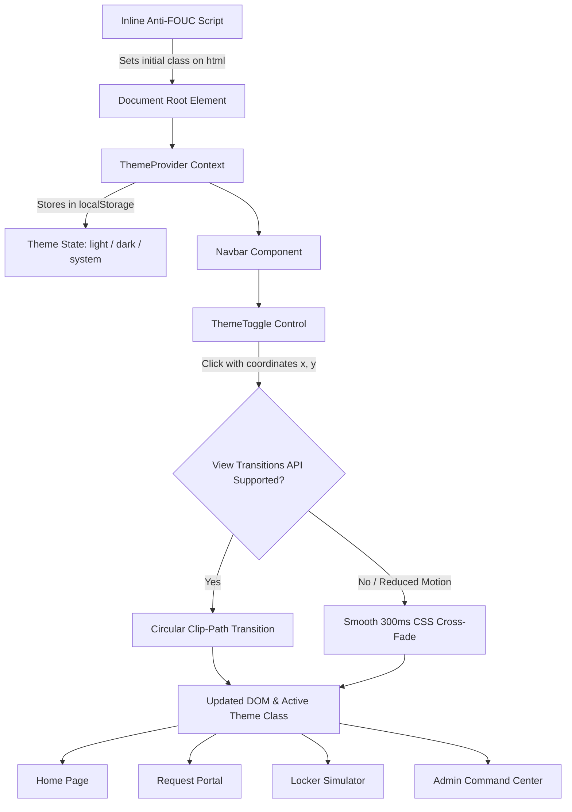

# 🌓 Implementation Plan: Dark & Light Mode System with Fluid Animation

> **Project:** KioskDrop Enterprise  
> **Status:** Draft / Ready for Review  
> **Target Scope:** System-wide Light & Dark Themes, Circular Ripple View Transition, Anti-FOUC Hydration, and Page-by-Page Aesthetic Refinement.

---

## 1. Executive Summary & Objectives

KioskDrop Enterprise currently defaults to a hardcoded dark aesthetic (`className="dark"` on `<html>`). This plan outlines the end-to-end architecture for:
1. **A Complete, Premium Light Theme**: Designing an executive-grade light theme across all pages (Home, Rapid-Drop QR Request, IoT Locker Simulator, and ITAM/FinOps Command Center) using a clean Slate, Zinc, and Enterprise Royal Blue palette.
2. **Fluid Circular Ripple Animation**: Implementing a state-of-the-art circular clip-path expansion animation powered by the modern **View Transitions API** (`document.startViewTransition`), originating from the user's click coordinates with smooth easing and reduced-motion fallback.
3. **Robust Theme Provider & Zero FOUC**: Storing preferences (`light` | `dark` | `system`) in `localStorage`, synchronizing across browser tabs with the `storage` event, and preventing any Flash of Unstyled Content (FOUC) using a synchronous inline pre-hydration script.
4. **Adaptive Chart & Sensor Telemetry Visuals**: Updating interactive components (Recharts data graphs, animated solenoid door latches, IR sensors, and keypad) to dynamically adapt contrast, tooltips, and gridlines to both themes.

---

## 2. Design System & Palette Specification

### A. Semantic Token Mapping (`src/app/globals.css`)

We will calibrate Tailwind's HSL semantic tokens to deliver optimal contrast and depth in both modes:

| Token | Light Theme (`:root`) | Dark Theme (`.dark`) | Purpose |
| :--- | :--- | :--- | :--- |
| **`--background`** | `210 20% 98%` (`#F8FAFC`) | `224 71% 4%` (`#020817`) | Main canvas background |
| **`--foreground`** | `222.2 84% 4.9%` (`#020817`) | `210 40% 98%` (`#F8FAFC`) | Primary text and headings |
| **`--card`** | `0 0% 100%` (`#FFFFFF`) | `224 71% 7%` (`#0B1120`) | Elevated surface / bay containers |
| **`--card-foreground`**| `222.2 84% 4.9%` | `210 40% 98%` | Card body and header text |
| **`--border`** | `214.3 31.8% 91.4%` (`#E2E8F0`)| `217 33% 20%` (`#1E293B`) | Structural dividers & bay outlines |
| **`--muted`** | `210 40% 96.1%` (`#F1F5F9`) | `217 33% 17%` (`#1E293B`) | Secondary backgrounds & pills |
| **`--muted-foreground`**| `215.4 16.3% 46.9%` (`#64748B`)| `215 20% 65%` (`#94A3B8`) | Subtitles, metadata, timestamps |
| **`--primary`** | `221.2 83.2% 53.3%` (`#2563EB`)| `217 91% 60%` (`#3B82F6`) | Brand action blue (buttons, active tabs) |
| **`--secondary`** | `210 40% 96.1%` (`#F1F5F9`) | `217 33% 17%` (`#1E293B`) | Hover states & chip tags |
| **`--accent`** | `210 40% 96.1%` (`#F1F5F9`) | `217 33% 17%` (`#1E293B`) | Subtle interactive highlights |

### B. Status Indicator Tokens (Both Themes)

Status badges and sensor indicators will use soft tinted backgrounds with high-contrast text:
* **Healthy / Available**: 
  - *Light:* `bg-emerald-50 text-emerald-700 border-emerald-200`
  - *Dark:* `bg-emerald-500/10 text-emerald-400 border-emerald-500/20`
* **Reserved / In Progress**: 
  - *Light:* `bg-amber-50 text-amber-800 border-amber-200`
  - *Dark:* `bg-amber-500/10 text-amber-400 border-amber-500/20`
* **Quarantine / Alarm**: 
  - *Light:* `bg-rose-50 text-rose-700 border-rose-200`
  - *Dark:* `bg-rose-500/10 text-rose-400 border-rose-500/20`
* **Active / Telemetry**: 
  - *Light:* `bg-blue-50 text-blue-700 border-blue-200`
  - *Dark:* `bg-blue-500/10 text-blue-400 border-blue-500/20`

---

## 3. Architecture & Component Blueprint



### 1. Anti-FOUC Script (`src/app/layout.tsx`)
Injected directly inside `<head>` before any body markup renders:
```html
<script
  dangerouslySetInnerHTML={{
    __html: `
      (function() {
        try {
          const stored = localStorage.getItem('kioskdrop-theme');
          const isDark = stored === 'dark' || (!stored && window.matchMedia('(prefers-color-scheme: dark)').matches);
          if (isDark) {
            document.documentElement.classList.add('dark');
          } else {
            document.documentElement.classList.remove('dark');
          }
        } catch (_) {}
      })();
    `,
  }}
/>
```

### 2. Modern Circular Clip-Path Transition (`src/lib/theme-transition.ts`)
When toggling theme, we calculate the distance to the farthest viewport corner from the click event:
```typescript
export function transitionTheme(newTheme: "light" | "dark", event?: React.MouseEvent) {
  if (
    !document.startViewTransition ||
    window.matchMedia("(prefers-reduced-motion: reduce)").matches
  ) {
    applyThemeClass(newTheme);
    return;
  }

  const x = event?.clientX ?? window.innerWidth / 2;
  const y = event?.clientY ?? window.innerHeight / 2;
  const endRadius = Math.hypot(
    Math.max(x, window.innerWidth - x),
    Math.max(y, window.innerHeight - y)
  );

  const transition = document.startViewTransition(() => {
    applyThemeClass(newTheme);
  });

  transition.ready.then(() => {
    document.documentElement.animate(
      {
        clipPath: [
          `circle(0px at ${x}px ${y}px)`,
          `circle(${endRadius}px at ${x}px ${y}px)`,
        ],
      },
      {
        duration: 450,
        easing: "cubic-bezier(0.4, 0, 0.2, 1)",
        pseudoElement: "::view-transition-new(root)",
      }
    );
  });
}
```

### 3. View Transitions CSS Config (`src/app/globals.css`)
```css
::view-transition-old(root),
::view-transition-new(root) {
  animation: none;
  mix-blend-mode: normal;
}
::view-transition-old(root) {
  z-index: 1;
}
::view-transition-new(root) {
  z-index: 9999;
}
```

---

## 4. Page-by-Page Light Theme Refinement Plan

### 1. Navigation Bar (`src/components/Navbar.tsx`)
* **Light Styling**: Frosted glass `bg-white/85 backdrop-blur-md border-b border-slate-200/80 shadow-sm`.
* **Brand Logo**: High-contrast royal blue shield with dark navy title text (`text-slate-900`).
* **Active Links**: Royal blue accent pill (`bg-primary text-white shadow-sm shadow-primary/20`).
* **Persona Switcher**: Elevated white button with subtle slate border and clean dropdown shadow (`shadow-lg border-slate-200`).
* **Theme Toggle Button**: Sun and Moon icon with spring rotation and scale animation (`transition-transform duration-300`).

### 2. Home Portal (`src/app/page.tsx`)
* **Canvas Background**: Smooth gradient from `slate-50` through `white` to subtle cool `blue-50/20`.
* **Hero Section**: Deep slate typography with a high-contrast enterprise badge (`bg-blue-50 text-blue-700 border-blue-200`).
* **Three Gateway Cards**:
  - Pure white background (`bg-white border-slate-200`).
  - Hover state: Gentle elevation `hover:border-blue-400 hover:shadow-lg hover:-translate-y-0.5`.
  - Icon containers: Soft royal blue tints (`bg-blue-50 text-blue-600 group-hover:scale-110`).

### 3. Employee Diagnostic & Request Portal (`src/app/request/page.tsx`)
* **Room Selector Bar**: Crisp white container with floor badge and room specifications.
* **Symptom Cards**:
  - Inactive: Clean border `border-slate-200 bg-white hover:border-slate-300 hover:bg-slate-50/50`.
  - Selected: Distinct royal blue outline `border-primary bg-primary/5 shadow-sm text-slate-900`.
* **Port Damage Toggle**: High-contrast toggle switch with clear orange warning callout.
* **Dispatch OTP Modal / Card**:
  - High-visibility monospace 6-digit PIN box (`bg-slate-50 border-slate-200 text-slate-900 shadow-inner`).
  - Copy PIN feedback animation (`Check` icon with green highlight).
  - Clean expiry countdown pill.

### 4. Smart Locker Simulator (`src/app/kiosk-simulator/page.tsx`)
* **Locker Frame Chassis**:
  - Brushed corporate gray frame (`bg-slate-100/90 border-slate-300 shadow-sm`).
* **12 Locker Bays**:
  - **Available Bay (`STOCKED_AVAILABLE`)**: White background (`bg-white`), slate text, emerald presence dot, and subtle solenoid status.
  - **Reserved Bay (`RESERVED_FOR_PICKUP`)**: Amber border glow (`border-amber-400 bg-amber-50/40`), pulsating pickup indicator.
  - **Door Open Bay (`DOOR_OPEN_AWAITING_REMOVAL`)**: Blue highlight with physical swinging door angle animation.
  - **Quarantine Bay (`MAINTENANCE_QUARANTINE`)**: Rose background (`bg-rose-50/80 border-rose-300 text-rose-800`).
* **Hardware Sensors Box**:
  - Real-time IR beam break sensor and 5V/3A charging continuity indicator styled with crisp green/gray LED dots.
* **Interactive PIN Keypad**:
  - Pure white physical-style number buttons (`bg-white hover:bg-slate-50 active:bg-slate-100 border-slate-200 text-slate-900 shadow-sm`) with tactile depression on click.

### 5. ITAM & FinOps Command Center (`src/app/admin/page.tsx`)
* **Summary KPI Cards**: Pure white cards with slate borders, crisp numeric typography, and colored icon accents.
* **Recharts Visualizations**:
  - Dynamic axis tick color (`#64748B` in light, `#94A3B8` in dark).
  - Dynamic grid stroke (`#E2E8F0` in light, `#1E293B` in dark).
  - Custom tooltip with white container, slate shadow, and dark text.
* **Statutory Duty Calculator**:
  - Crisp form inputs with clean blue focus rings.
  - Landed-cost summary table with soft alternating row zebra striping (`even:bg-slate-50`).
* **Tamper-Evident SHA-256 Custody Logs**:
  - Monospace hash badges in `bg-slate-100 text-slate-700 border-slate-200`.
  - Verified chain link icons and cryptographic signatures.

---

## 5. Implementation Milestones

```mermaid
gantt
    title Light Mode & Smooth Animation Implementation
    dateFormat  X
    axisFormat %s
    section Core Infrastructure
    1. ThemeProvider & Anti-FOUC Script         :a1, 0, 1
    2. View Transitions & Circular Ripple CSS   :a2, 1, 2
    section Components & Layout
    3. Navbar ThemeToggle Component             :a3, 2, 3
    4. Home Page Light Styling                  :a4, 3, 4
    section Portals & Simulator
    5. Request Portal Light Refinement          :a5, 4, 5
    6. Kiosk Locker Simulator & Keypad Styling  :a6, 5, 6
    section Analytics & Verification
    7. Admin Command Center & Recharts Tuning   :a7, 6, 7
    8. Quality Gates (Build, Tests & Visual)    :a8, 7, 8
```



| Step | Action | Files Touched |
| :--- :--- | :--- |
| **Step 1** | Create `ThemeProvider` context and add inline anti-FOUC script in root layout. Remove hardcoded `className="dark"` on `<html>`. | `src/components/ThemeProvider.tsx`, `src/app/layout.tsx` |
| **Step 2** | Add View Transitions API CSS tokens and helper for circular clip-path transition. | `src/app/globals.css`, `src/lib/theme-transition.ts` |
| **Step 3** | Build accessible, animated `ThemeToggle` component with Sun/Moon micro-animations and integrate into the Navbar. | `src/components/ThemeToggle.tsx`, `src/components/Navbar.tsx` |
| **Step 4** | Refine Home page (`/`) cards, typography, and background gradients for light mode. | `src/app/page.tsx` |
| **Step 5** | Refine Request portal (`/request`) symptom cards, room dropdowns, and PIN modal for light mode. | `src/app/request/page.tsx` |
| **Step 6** | Refine Kiosk Simulator (`/kiosk-simulator`) 12-bay locker bank, solenoid animations, and keypad for light mode. | `src/app/kiosk-simulator/page.tsx` |
| **Step 7** | Refine Command Center (`/admin`) KPI cards, Recharts chart colors, duty table, and custody log hashes. | `src/app/admin/page.tsx` |
| **Step 8** | Run complete quality gates: `tsc --noEmit`, `npm run build`, and verify in browser with browser tools. | Full application |

---

## 6. Verification & Quality Gates

* **Zero FOUC Check**: Force refresh in both light and dark modes to verify that no flash of unstyled theme occurs.
* **Smooth Animation Check**: Test theme switching on Chrome/Edge with View Transitions API (circular reveal) and fallback cross-fade on unsupported engines or reduced-motion.
* **Contrast & A11y (WCAG AA)**: Verify text contrast ratio $\ge 4.5:1$ across all cards, buttons, badges, and tables in both light and dark modes.
* **Component Functionality**:
  - Locker solenoid animations work cleanly in both themes.
  - Keypad numbers and sound/visual feedback are crisp and legible.
  - Recharts tooltips and axis labels render with readable contrast.
* **Build & Regression**: `npm run typecheck`, `npm run build`, and `npm run test` must pass with 100% success.
